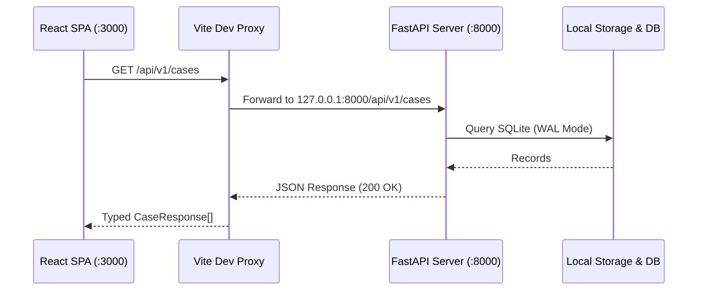

# Q-TRACE Frontend-to-Backend Integration Guide

## 1. Integration Architecture & Network Proxy

The Q-TRACE frontend interacts with the FastAPI backend through a centralized, typed API service layer located at [`frontend/src/services/api.ts`](file:///d:/WebDev%20PROJECTS/quantum%20qtrace/frontend/src/services/api.ts).

During local development, Vite proxies all `/api` and `/health` requests to `http://127.0.0.1:8000` (`vite.config.ts`), eliminating cross-origin resource sharing (CORS) complications and port hardcoding:



For production builds, the client reads `VITE_API_BASE_URL` from the environment, defaulting to an empty prefix for reverse proxy deployments (such as Nginx).

---

## 2. Type-Safe Client Contracts

All request payloads and response envelopes are strictly typed using TypeScript interfaces mirroring backend Pydantic models:

| Method in `api.ts` | Backend Endpoint | Request Type | Response Type |
| :--- | :--- | :--- | :--- |
| `getHealth()` | `GET /api/v1/health` | None | `HealthResponse` |
| `getSystemInfo()` | `GET /api/v1/system/info` | None | `SystemInfoResponse` |
| `getCases(page, size)` | `GET /api/v1/cases` | Query parameters | `PaginatedResponse<CaseResponse>` |
| `getCase(caseId)` | `GET /api/v1/cases/{id}` | Path parameter | `CaseDetailResponse` |
| `createCase(payload)` | `POST /api/v1/cases` | `CaseCreate` (JSON) | `CaseResponse` |
| `updateCase(caseId, payload)` | `PATCH /api/v1/cases/{id}` | `CaseUpdate` (JSON) | `CaseResponse` |
| `addNote(caseId, payload)` | `POST /api/v1/cases/{id}/notes` | `ExaminerNoteCreate` (JSON) | `ExaminerNoteResponse` |
| `uploadEvidence(caseId, file)` | `POST /api/v1/cases/{id}/evidence` | `FormData` (multipart) | `EvidenceResponse` |
| `listCaseEvidence(caseId)` | `GET /api/v1/cases/{id}/evidence` | Path parameter | `EvidenceResponse[]` |
| `listAllEvidence(page, size)` | `GET /api/v1/evidence` | Query parameters | `PaginatedResponse<EvidenceResponse>` |
| `getEvidence(evidenceId)` | `GET /api/v1/evidence/{id}` | Path parameter | `EvidenceResponse` |
| `getEvidenceFileUrl(evidenceId)` | `GET /api/v1/evidence/{id}/file` | Path parameter | Raw Binary Stream URL (`FileResponse`) |
| `verifyEvidence(evidenceId)` | `POST /api/v1/evidence/{id}/verify` | Path parameter | `EvidenceVerifyResponse` |
| `compareQuantumPatches(payload)` | `POST /api/v1/quantum/compare` | `QuantumComparisonRequest` (JSON) | `QuantumComparisonResponse` |

---

## 3. Multipart Evidence Upload Contract

Evidence files are uploaded via standard HTML5 `FormData`:

```typescript
uploadEvidence: (caseId: string, file: File): Promise<EvidenceResponse> => {
  const formData = new FormData();
  formData.append("file", file);
  return request<EvidenceResponse>(`/api/v1/cases/${caseId}/evidence`, {
    method: "POST",
    body: formData,
  });
}
```

- When `body` is an instance of `FormData`, the client omits the manual `Content-Type: application/json` header, allowing the browser to set `multipart/form-data; boundary=...` automatically.
- The backend parses the binary stream, executes magic-byte validation, streams bytes through SHA-256, and writes to WORM storage.

---

## 4. Serving Image Binaries for Forensic Display

To display preserved evidence photographs in `` tags and the `ForensicImageViewer` without exposing internal filesystem paths, the client requests the dedicated streaming endpoint:

$$\text{Image URL} = \text{API\_BASE} + \text{"/api/v1/evidence/"} + \text{evidenceId} + \text{"/file"}$$

The backend validates the evidence ID, verifies that the physical file exists in `storage/originals/`, and returns a `FileResponse` with the original MIME media type (`image/jpeg`, `image/png`, `image/tiff`).

---

## 5. Standardized Error Unwrapping

When the backend returns a 4xx or 5xx status code, the client parses the standardized JSON error envelope:

```json
{
  "error": {
    "code": "INTEGRITY_VIOLATION",
    "message": "A case with case number 'QC-2026-0001' already exists.",
    "details": {}
  }
}
```

The error is instantiated as a typed `ApiError`:
```typescript
throw new ApiError(errorDetails.message, errorDetails.code, response.status, errorDetails.details);
```

UI components catch this exception to provide specific feedback (e.g. advising the examiner to choose another case number on 409 Conflict, or highlighting unsupported magic bytes on 422).

