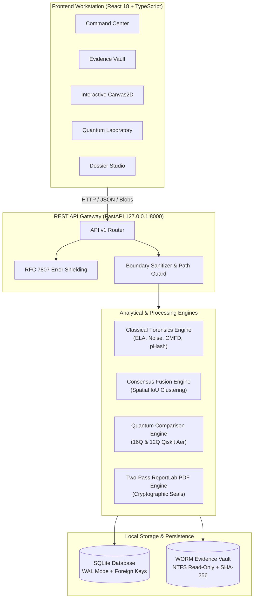

# Q-TRACE: System Architecture & Engineering Blueprint

**Document Reference:** `docs/ARCHITECTURE.md`  
**Classification:** Core System Architecture & Engineering Specifications  
**Version:** 1.10.0 (Part 10 Final Submission)  

---

## 1. High-Level Architecture Overview

Q-TRACE is an offline-first, local-only digital image forensics and evidence intelligence workstation. It is engineered specifically to investigate suspected motor-vehicle insurance claims photography fraud.

The platform follows a clean decoupled client-server architecture:
- **Presentation Layer (Frontend):** React 18, TypeScript, Tailwind CSS, and Vite. Implements a dark forensic design system with 11 specialized investigation views, sub-pixel Canvas2D viewport manipulation, and interactive SVG quantum circuit visualizers.
- **Application & Forensic Layer (Backend):** FastAPI (Python 3.11+) service executing non-destructive classical signal processing, cryptographic verification, and IBM Qiskit Aer quantum statevector simulations.
- **Persistence & Evidence Layer:** SQLite with Write-Ahead Logging (WAL) concurrency, coupled with a Write-Once-Read-Many (WORM) content-addressed file storage vault.

---

## 2. Core Subsystems

### 2.1 Cryptographic WORM Evidence Vault
Original photographic evidence must never be altered during analysis:
1. **Hardware Hashing:** Upon ingestion, raw file streams are hashed using NIST FIPS 180-4 SHA-256.
2. **Content-Addressed Storage:** Files are stored in `storage/originals/<sha256>_<sanitized_name>`.
3. **Immutability Enforcement:** The host operating system read-only bit (`stat.S_IREAD`) is applied.
4. **Pre-Flight Integrity Verification:** Before every analytical run, physical on-disk bytes are recalculated; any tampering halts processing immediately with an `IntegrityException`.

### 2.2 Classical Digital Forensics Engine
Executes modular, non-destructive image analyses:
- **Error Level Analysis (ELA):** Multi-quality JPEG recompression difference mapping with edge masking.
- **Sensor Noise Inconsistency:** PRNU extraction via median filtration ($k=3$) and $16 \times 16$ sliding block variance estimation.
- **Copy-Move Forgery Detection (CMFD):** SIFT feature keypoint matching with Lowe's ratio test and parallel displacement vector clustering.
- **Perceptual Hashing:** 64-bit aHash, dHash, and pHash Hamming distance calculations.

### 2.3 Consensus Evidence Fusion Engine
Eliminates isolated false alarms on metallic vehicle body seams:
- Merges candidate bounding boxes from orthogonal physical domains where spatial $\text{IoU} \ge 0.20$.
- Elevates cross-validation confidence scores for regions corroborated across multiple independent techniques:
  $$S_{fused} = \min\left(0.99, \; \frac{1}{|C|} \sum_{r \in C} r.s + 0.15 \times (K - 1)\right)$$

### 2.4 Quantum Image Processing Laboratory
Operates on investigator-selected $4 \times 4$ Region of Interest (ROI) micro-patches:
- **16-Qubit Dedicated Register:** 4 position qubits, 4 original intensity qubits, 4 modified intensity qubits, and 4 dedicated difference qubits. Bitwise XOR mapped via 8 transverse CNOT gates.
- **12-Qubit Compact In-Place:** Reversibly computes differences directly into target registers, saving $25\%$ of qubits and $16\times$ simulation memory.
- **Coupon Collector Measurement Readout:** Reconstructs difference maps from measurement counts; encodes unobserved coordinates strictly as `-1`.

### 2.5 Dossier & Courtroom Report Engine
Compiles frozen investigation snapshots into multi-page PDFs using ReportLab:
- Two-pass `NumberedCanvas` dynamically calculates total page counts ("Page X of Y").
- Running headers, confidentiality notices, and embedded cryptographic verification seals.
- Categorizes findings into Facts, Observations, Indicators, Hypotheses, and Conclusions.
