# Q-TRACE Classical Digital Image Forensics Architecture

**Document ID:** `DOC-ARCH-005`  
**Classification:** Core System Architecture Specification  
**Version:** 1.0.0 (Part 5 Milestone Deliverable)  
**Author:** Q-TRACE Principal Architecture & Forensics Engineering Team  
**System Status:** Implemented & Verified (90 Backend Tests, 13 Frontend Tests Passing)

---

## 1. Executive Architectural Overview

The **Classical Digital Image Forensics Engine** is the operational backbone of Q-TRACE. While the Quantum Laboratory provides patch-level algebraic verification for high-priority suspicious regions, the Classical Engine executes full-resolution, multi-scale, physics- and signal-based analysis pipelines across uploaded photographic evidence.

Forensic image analysis presents a fundamental scientific challenge: **no single algorithm can be trusted in isolation**.
- **Error Level Analysis (ELA)** flags high-contrast natural vehicle body lines as false positives.
- **Keypoint-based Copy-Move Detection (CMFD)** fails on smooth, textureless panels (e.g. polished car hoods).
- **Noise Inconsistency Analysis** fails if an entire image has been uniformly downsampled and social-media compressed.
- **Metadata Analysis** can be completely stripped by messaging apps without malicious intent.

Q-TRACE resolves this through **Orthogonal Signal Fusion**: combining independent, deterministic algorithms operating across disparate physical, optical, and frequency domains into an explainable **Consensus Evidence Map**.

---

## 2. Directory Layout & Subsystem Structure

The classical forensic engine resides under `backend/app/forensics/`, adhering to strict separation of concerns:

```
backend/app/forensics/
├── base.py                   # Abstract Base Class ForensicTechnique with common contracts
├── schemas.py                # Pydantic data schemas: Findings, RoIs, Artifacts, Responses
├── exceptions.py             # Typed domain exceptions (UnsupportedImage, TechniqueExecution)
├── registry.py               # Singleton discovery and catalog registry for forensic modules
├── pipeline.py               # Orchestrator: WORM integrity checks, execution, persistence
├── consensus_fusion.py       # Multi-signal RoI clustering and IoU-based consensus scoring
├── metadata_analyzer.py      # EXIF, container headers, software signatures, C2PA markers
├── ela_analyzer.py           # Error Level Analysis with edge masking & candidate extraction
├── noise_analyzer.py         # PRNU sensor noise floor residuals and block variance mapping
├── copy_move_analyzer.py     # SIFT/ORB keypoint matching, ratio test, parallel vector clustering
├── statistics_analyzer.py    # 256-bin RGB/Luminance histograms, Shannon entropy, clipping
├── perceptual_hash_analyzer.py # aHash, dHash, DCT-based pHash, Hamming distance comparisons
└── resampling_analyzer.py    # Sobel gradients, Laplacian texture variance, inpainting masks
```

---

## 3. High-Level Data Flow Architecture

```mermaid
flowchart TD
    subgraph EvidenceStorage [WORM Evidence Storage Layer]
        EV[Original Evidence File<br/>storage/originals/hash.ext]
        HASH[Ingestion SHA-256 Digest]
    end

    subgraph PipelineOrchestration [Forensic Pipeline Coordinator]
        VERIFY{Verify Bitstream<br/>Integrity SHA-256}
        READ[Read In-Memory Bytes<br/>Zero Disk Mutation]
        DISPATCH[Sequential Execution<br/>with Failure Isolation]
    end

    subgraph ForensicModules [Registered Forensic Algorithms]
        M1[Metadata & EXIF]
        M2[Error Level Analysis ELA]
        M3[Sensor Noise Inconsistency]
        M4[Copy-Move SIFT CMFD]
        M5[Multi-Channel Statistics]
        M6[Perceptual Hashes]
        M7[Resampling & Inpainting]
    end

    subgraph ConsensusEngine [Consensus & Artifact Engine]
        FUSE[Spatial IoU Clustering<br/>& Score Calibration]
        Q_PATCH[Quantized 4x4 Patch<br/>for Quantum Lab Handoff]
        ART[Artifact Generation<br/>storage/analysis/art_hash.png]
    end

    subgraph Persistence [Database Persistence]
        DB_A[(Analysis Record<br/>results_json, status)]
        DB_ART[(Artifact Records<br/>type, hash, path)]
    end

    EV --> VERIFY
    HASH --> VERIFY
    VERIFY -->|Intact| READ
    VERIFY -->|Mismatch| COMPROMISED[Abort Analysis<br/>Mark Compromised]

    READ --> DISPATCH
    DISPATCH --> M1 & M2 & M3 & M4 & M5 & M6 & M7

    M1 & M2 & M3 & M4 & M5 & M6 & M7 --> FUSE
    FUSE --> Q_PATCH
    M2 & M3 & M4 & M5 & M7 --> ART

    FUSE --> DB_A
    ART --> DB_ART
```



---

## 4. Core Design Principles & Guarantees

### 4.1 Strict WORM Evidence Immutability
Under no circumstances does any forensic algorithm modify, overwrite, or delete an original evidence file:
- The original evidence is stored with OS-level read-only permissions (`stat.S_IREAD`).
- The pipeline verifies the physical file's SHA-256 hash before commencing analysis.
- Image operations read bytes directly into RAM (`io.BytesIO`) or temporary NumPy arrays.
- Analysis outputs (difference maps, heatmaps, plots) are written exclusively to `storage/analysis/` with distinct content-addressed names.

### 4.2 Failure Isolation
A failure in one algorithm must never crash the entire analysis:
- Each technique runs within an isolated `try/except` boundary.
- If an algorithm encounters unsupported input (e.g., ELA on an uncompressed PNG or CMFD on a textureless surface), it records an explicit `UNSUPPORTED_INPUT` or `INCONCLUSIVE` status with detailed diagnostic warnings.
- The pipeline returns partial successes accurately as `PARTIAL_SUCCESS`.

### 4.3 Taxonomic Finding Separation
The system strictly adheres to the 4-tier evidentiary taxonomy:
1. **Observations**: Directly measured technical properties (e.g. format: JPEG, mean ELA error: 4.82/255, entropy: 7.41 bits).
2. **Indicators**: Statistically significant anomalies warranting examiner inspection (e.g. high-error clusters outside natural edges, parallel cloned vector clusters, Photoshop software tag).
3. **Hypotheses**: Scientific hypotheses explaining the anomaly (e.g. "Suspected foreign splice from differing compression source").
4. **Examiner Conclusions**: Human-adjudicated findings recorded in case notes.

### 4.4 Local-First & Windows 11 Resource Discipline
- **Zero Cloud / Zero External API Dependency**: All processing runs locally on the host CPU.
- **Decompression Bomb Protection**: Pillow and OpenCV limits are strictly enforced.
- **Memory Footprint**: Image matrices are processed in standard 8-bit or 32-bit floating point arrays; large images are processed using block-based generators ($16 \times 16$ or $32 \times 32$ windows) to maintain RAM usage $< 150 \text{ MB}$ per analysis.
- **Quantum Lab Bridge**: Candidate anomalies automatically yield downsampled $4 \times 4$ matrices quantized to $[0, 15]$ for direct handoff to the Qiskit NEQR circuit.

