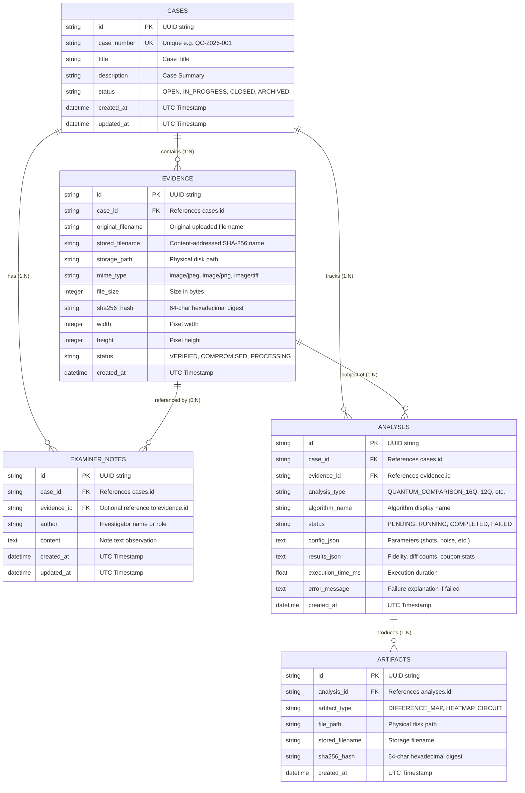

# Q-TRACE Database Design & Data Modeling Specification

## 1. Relational Database Architecture

The Q-TRACE persistence layer utilizes **SQLite 3** operating with **Write-Ahead Logging (WAL)** mode through **SQLAlchemy 2.0+** ORM.

### 1.1 Rationale for SQLite in WAL Mode
For a university research and forensic intelligence platform deployed on a local workstation, SQLite provides compelling advantages over heavy database daemons (PostgreSQL / MySQL):
1. **Zero External Daemon Overhead**: Runs in-process without requiring background services, port binding, or credential management.
2. **ACID Concurrency via WAL (`PRAGMA journal_mode=WAL;`)**:
   - In traditional rollback-journal mode, writers block readers and readers block writers.
   - In WAL mode, changes are written sequentially to a separate `-wal` file. Readers read from the database file and WAL concurrently without locking writers. A single writer can proceed without blocking ongoing investigative reads.
3. **Foreign Key Enforcement (`PRAGMA foreign_keys=ON;`)**:
   - SQLite disables foreign keys by default for backward compatibility. Q-TRACE automatically enforces strict referential integrity on every database connection via an SQLAlchemy `connect` event listener.
4. **Fast Synchronous Commit (`PRAGMA synchronous=NORMAL;`)**:
   - Provides full crash resistance without requiring synchronous disk flushes on every write, improving transaction throughput on solid-state drives.

---

## 2. Entity-Relationship (ER) Diagram

---

## 3. Relational Tables Specification

### 3.1 `cases` Table
Maintains investigative boundaries for claims and incident reviews.
- **Primary Key**: `id` (`VARCHAR(36)` UUID)
- **Unique Key**: `case_number` (`VARCHAR(64)`, Indexed) — human-readable identifier (e.g. `QC-2026-0001`).
- **Fields**: `title`, `description`, `status` (`OPEN`, `IN_PROGRESS`, `CLOSED`, `ARCHIVED`), `created_at`, `updated_at`.
- **Cascade Behavior**: Deletion of a case cascades to all associated notes, evidence items, and analysis records.

### 3.2 `evidence` Table
Preserves digital evidence records, metadata, and cryptographic digests.
- **Primary Key**: `id` (`VARCHAR(36)` UUID)
- **Foreign Key**: `case_id` (`VARCHAR(36)`) references `cases.id` with `ON DELETE CASCADE`.
- **Fields**: `original_filename`, `stored_filename`, `storage_path`, `mime_type`, `file_size`, `sha256_hash` (Indexed), `width`, `height`, `status` (`VERIFIED`, `COMPROMISED`, `PROCESSING`, `ERROR`), `created_at`.
- **Integrity Rule**: `sha256_hash` represents the SHA-256 digest computed at the moment of file ingestion.

### 3.3 `analyses` Table
Tracks algorithmic executions (quantum simulations, classical XOR comparisons, future ELA/noise runs).
- **Primary Key**: `id` (`VARCHAR(36)` UUID)
- **Foreign Keys**:
  - `case_id` references `cases.id` (`ON DELETE CASCADE`)
  - `evidence_id` references `evidence.id` (`ON DELETE CASCADE`)
- **Fields**: `analysis_type`, `algorithm_name`, `status` (`PENDING`, `RUNNING`, `COMPLETED`, `FAILED`), `config_json` (Text), `results_json` (Text), `execution_time_ms` (Float), `error_message` (Text), `created_at`.
- **Flexibility**: Storing parameters and output metrics in structured JSON text fields ensures seamless extensibility across different algorithmic families without schema migration churn.

### 3.4 `artifacts` Table
Records derived binary outputs produced by analyses (such as difference maps, heatmaps, and quantum circuit diagrams).
- **Primary Key**: `id` (`VARCHAR(36)` UUID)
- **Foreign Key**: `analysis_id` references `analyses.id` (`ON DELETE CASCADE`).
- **Fields**: `artifact_type`, `file_path`, `stored_filename`, `sha256_hash`, `created_at`.

### 3.5 `examiner_notes` Table
Chronicles investigator observations, audit remarks, and viva presentation notes.
- **Primary Key**: `id` (`VARCHAR(36)` UUID)
- **Foreign Keys**:
  - `case_id` references `cases.id` (`ON DELETE CASCADE`)
  - `evidence_id` references `evidence.id` (`ON DELETE SET NULL`)
- **Fields**: `author`, `content`, `created_at`, `updated_at`.

