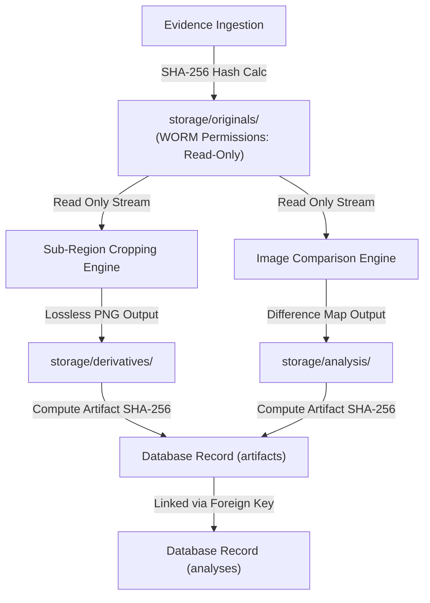

# Derived Artifacts, Storage Hierarchy and Chain of Custody

**Document ID**: `DOC-PART6-006`  
**Classification**: Systems Architecture & Data Storage Specification  
**Version**: `1.0.0`  
**Status**: `ACTIVE / PRODUCTION`  
**Target Platform**: Q-TRACE Storage Subsystem

---

## 1. Storage Isolation and Write-Once-Read-Many (WORM) Integrity

Digital forensic standards require physical and logical separation between original primary evidence and derivative artifacts generated during investigation. Under no circumstances may an analysis process, crop operation, or alignment transformation overwrite an evidentiary file.

Q-TRACE enforces a partitioned physical storage hierarchy:

```
storage/
├── originals/          [WORM: Read-Only, Cryptographically Locked]
│   └── <sha256>.ext    (Original evidentiary camera uploads)
├── derivatives/        [Derivative Crops: Lossless PNG Sub-Regions]
│   └── crop_<roi_id>_<sha256_short>.png
├── analysis/           [Analytical Visualizations: Heatmaps & Delta Maps]
│   └── diff_<primary_id>_<comp_id>_<timestamp>.png
├── reports/            [Generated Courtroom Reports: PDF/JSON]
└── temp/               [Ephemeral Scratch: Discarded post-execution]
```



---

## 2. ROI Sub-Region Cropping Pipeline

When an examiner extracts a cropped sub-region from a Region of Interest via `POST /api/v1/rois/{roi_id}/crop`:

1. **Evidence Resolution**: The service loads the original file from `storage/originals/` using Pillow / OpenCV.
2. **Boundary Validation**: The requested $(X, Y, W, H)$ rectangle is verified against original image dimensions:
   $$X_{crop} = \max(0, \min(W_{img} - 1, X)), \quad W_{crop} = \min(W, W_{img} - X_{crop})$$
   $$Y_{crop} = \max(0, \min(H_{img} - 1, Y)), \quad H_{crop} = \min(H, H_{img} - Y_{crop})$$
3. **Lossless Cropping**:
   $$\text{SubRegion} = \text{Image}[Y_{crop} : Y_{crop} + H_{crop}, \; X_{crop} : X_{crop} + W_{crop}]$$
   The sub-region is saved exclusively in lossless 24-bit PNG format to prevent secondary JPEG quantization distortion.
4. **Digest Calculation**: A SHA-256 cryptographic digest is computed immediately over the exported PNG bytes:
   $$\text{Digest} = \text{SHA256}(\text{PNG\_Bytes})$$
5. **Database Registration**:
   - Creates a parent `Analysis` record (`analysis_type = "ROI_CROP"`).
   - Inserts an `Artifact` record with `artifact_type = "ROI_CROP"`, referencing `storage_path = "storage/derivatives/crop_..."` and `sha256_hash = Digest`.
6. **Suggested Quantum Patch**: The pipeline automatically downsamples the crop to a $4 \times 4$ matrix normalized to $[0, 15]$ for immediate handoff to the Quantum Laboratory.

---

## 3. Database Schema Mapping

```sql
-- Artifacts table mapping derivative crops and visual analytics
CREATE TABLE artifacts (
    id VARCHAR(36) PRIMARY KEY,
    analysis_id VARCHAR(36) NOT NULL REFERENCES analyses(id) ON DELETE CASCADE,
    artifact_type VARCHAR(32) NOT NULL, -- 'ROI_CROP', 'DIFFERENCE_MAP', 'HEATMAP', 'CHART'
    storage_path VARCHAR(512) NOT NULL,
    mime_type VARCHAR(64) NOT NULL,
    file_size INTEGER NOT NULL,
    sha256_hash VARCHAR(64) NOT NULL,
    created_at DATETIME NOT NULL DEFAULT CURRENT_TIMESTAMP
);

CREATE INDEX ix_artifacts_analysis_id ON artifacts(analysis_id);
```

---

## 4. Derivative File Delivery API

Derivative crops and difference artifacts are served to the frontend via dedicated, secure streaming endpoints:

```http
GET /api/v1/derivatives/{artifact_id}/file HTTP/1.1
Host: localhost:8000
```

- **Security Verification**: Validates that `artifact_id` exists in the database and the physical file resides strictly within `storage/derivatives/` or `storage/analysis/`, preventing directory traversal attacks.
- **Cache Control**: Returns `Cache-Control: public, max-age=31536000, immutable` because artifacts are content-addressed and immutable once created.
- **MIME Streaming**: Returns `image/png` with `FileResponse` and explicit `Content-Length`.

