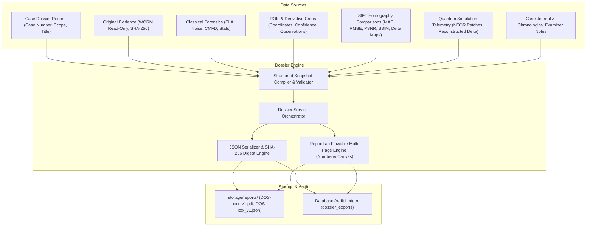
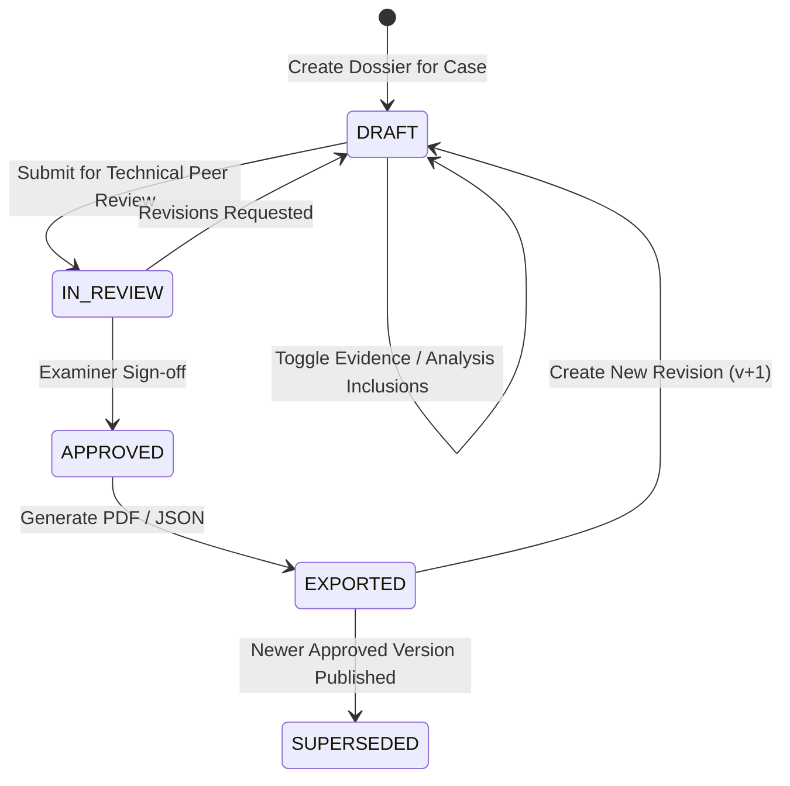

# Forensic Investigation Dossier System Architecture

**Document ID**: `DOC-PART7-001`  
**Classification**: Systems Architecture & Evidentiary Reporting Specification  
**Version**: `1.0.0`  
**Status**: `ACTIVE / PRODUCTION`  
**Target Platform**: Q-TRACE Forensic Workstation (Windows 11 / Local-First)

---

## 1. Architectural Philosophy and Mission

Digital forensic investigation platforms fail courtroom and regulatory scrutiny when reporting is an afterthought—such as taking client-side DOM screenshots, generating unversioned PDFs, or allowing automated algorithmic outputs to masquerade as legal determinations of fraud.

The **Q-TRACE Forensic Investigation Dossier System** is architected around five fundamental principles:

1. **Strict Evidentiary Traceability:** Every statement, measurement, and artifact embedded within a dossier is tied directly to underlying database records and immutable filesystem bitstreams.
2. **Two-Tier Evidentiary Separation:** Objective physical measurements (`facts` and `observations`) are strictly segregated from expert working theories (`hypotheses`) and human interpretations (`conclusions`).
3. **Immutable Version Freezing:** Generating a report creates an indelible cryptographic snapshot. Subsequent revisions increment the version number without overwriting previous exports.
4. **Local-First Zero-Cloud Security:** All compilation, rendering, and cryptographic hashing execute entirely on the local machine without transmitting evidentiary photographs to external cloud services.
5. **Multi-Modal Document Generation:** Produces both open, machine-readable JSON exports and publication-grade multi-page PDF documents.

---

## 2. Dossier Lifecycle State Machine

A dossier transitions through five explicit states:

| State | Forensic Meaning | Permitted Operations |
|:---|:---|:---|
| `DRAFT` | Initial compilation; scope and conclusions under active authoring. | Full editing of narrative text, evidence inclusions, and section order. |
| `IN_REVIEW` | Submitted for supervisor or technical peer review. | Reviewer commentary and annotation editing. |
| `APPROVED` | Verified by the lead forensic examiner; conclusions finalized. | Ready for formal document generation. |
| `EXPORTED` | Formal PDF or JSON report generated, hashed via SHA-256, and frozen. | Immutable; downloading permitted; editing triggers a version increment ($v+1$). |
| `SUPERSEDED` | Deprecated historical edition replaced by an amended version. | Retained in audit ledger for complete legal discovery. |

---

## 3. Core Subsystems

### 3.1 Structured Snapshot Compiler
The compiler aggregates all related case assets into a single normalized data structure:
- Resolves all selected evidence records from `storage/originals/`.
- Verifies physical file existence and verifies runtime bitstream invariance against recorded SHA-256 hashes.
- Ingests classical analysis runs and categorizes findings into 4 distinct evidentiary tiers.
- Ingests ROIs and links physical derivative crop artifacts from `storage/derivatives/`.
- Ingests SIFT homography comparison metrics, transformation matrices, and difference heatmap artifacts from `storage/analysis/`.
- Ingests quantum simulation results from IBM Qiskit runs.
- Extracts chronological examiner journal notes.
- Generates a **Completeness Statement** explicitly noting whether any evidence items were omitted by configuration.

### 3.2 ReportLab Multi-Page PDF Generation Engine
Built on top of ReportLab 5.1.0 using the `Platypus` flowable document architecture:
- Custom `NumberedCanvas` overrides `showPage()` and `save()` to perform dynamic two-pass pagination, printing "Page X of Y", running headers, and running footers on all pages except the cover.
- Standard A4 / Letter geometry with strict 36 pt (0.5 inch) margins.
- Clean typography and contrast conforming to WCAG 2.2 AA readability standards.
- Dynamic table autowrapping to prevent text clipping or margin overflow.
- Embedded high-resolution images for derivative ROI crops and SIFT difference heatmaps.

### 3.3 Open JSON Dossier Exporter
Serializes the entire compiled snapshot into an indented, human-readable JSON file. This guarantees full interoperability with external e-discovery platforms, insurance fraud databases, and legal archiving repositories.

### 3.4 Cryptographic Provenance & Export Ledger
When an export executes:
1. The exported byte stream (PDF or JSON) is hashed using NIST FIPS 180-4 SHA-256.
2. The file is saved to `storage/reports/{dossier_number}_v{version}.{ext}`.
3. A `DossierExportModel` row is created in SQLite, freezing the exact file size, SHA-256 hash, and full snapshot JSON.
4. The file is served via `GET /api/v1/dossiers/{id}/exports/{export_id}/file` with headers `X-Report-SHA256` and `X-Report-Version`.

