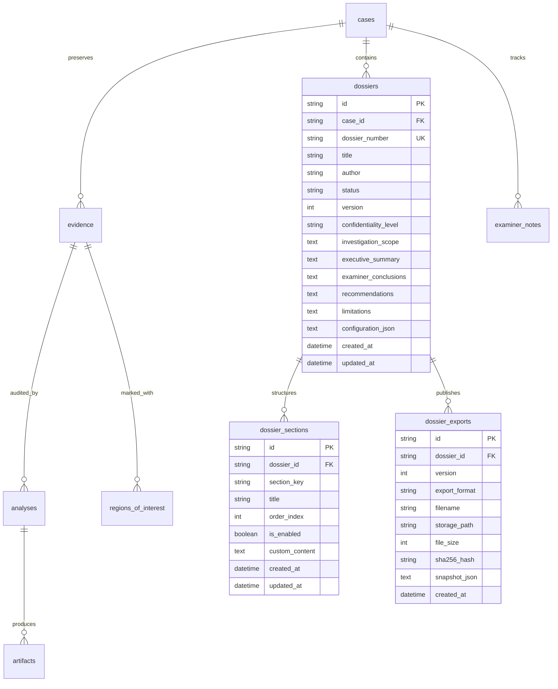

# Dossier Data Model and Relational Schema

**Document ID**: `DOC-PART7-002`  
**Classification**: Database Design & Schema Specification  
**Version**: `1.0.0`  
**Status**: `ACTIVE / PRODUCTION`  
**Target Platform**: SQLite (WAL Mode, Foreign Keys Enforced)

---

## 1. Entity-Relationship Architecture

The forensic dossier data model extends the Q-TRACE database foundation established in Part 3 and Part 6, introducing three new relational tables: `dossiers`, `dossier_sections`, and `dossier_exports`.



---

## 2. Table Specifications

### 2.1 Table: `dossiers`
Represents the top-level investigation dossier container.

```sql
CREATE TABLE dossiers (
    id VARCHAR(36) PRIMARY KEY,
    case_id VARCHAR(36) NOT NULL REFERENCES cases(id) ON DELETE CASCADE,
    dossier_number VARCHAR(64) NOT NULL UNIQUE,
    title VARCHAR(255) NOT NULL,
    author VARCHAR(128) NOT NULL DEFAULT 'Lead Forensic Examiner',
    status VARCHAR(32) NOT NULL DEFAULT 'DRAFT',
    version INTEGER NOT NULL DEFAULT 1,
    confidentiality_level VARCHAR(64) NOT NULL DEFAULT 'STRICTLY CONFIDENTIAL - FORENSIC EVIDENCE',
    investigation_scope TEXT,
    executive_summary TEXT,
    examiner_conclusions TEXT,
    recommendations TEXT,
    limitations TEXT,
    configuration_json TEXT,
    created_at DATETIME NOT NULL DEFAULT CURRENT_TIMESTAMP,
    updated_at DATETIME NOT NULL DEFAULT CURRENT_TIMESTAMP
);

CREATE INDEX ix_dossiers_case_id ON dossiers(case_id);
CREATE INDEX ix_dossiers_number ON dossiers(dossier_number);
CREATE INDEX ix_dossiers_status ON dossiers(status);
```

### 2.2 Table: `dossier_sections`
Enables dynamic re-ordering, enabling/disabling, and narrative overrides for the 13 standard report sections.

```sql
CREATE TABLE dossier_sections (
    id VARCHAR(36) PRIMARY KEY,
    dossier_id VARCHAR(36) NOT NULL REFERENCES dossiers(id) ON DELETE CASCADE,
    section_key VARCHAR(64) NOT NULL,
    title VARCHAR(128) NOT NULL,
    order_index INTEGER NOT NULL DEFAULT 0,
    is_enabled BOOLEAN NOT NULL DEFAULT 1,
    custom_content TEXT,
    created_at DATETIME NOT NULL DEFAULT CURRENT_TIMESTAMP,
    updated_at DATETIME NOT NULL DEFAULT CURRENT_TIMESTAMP
);

CREATE INDEX ix_dossier_sections_dossier_id ON dossier_sections(dossier_id);
```

### 2.3 Table: `dossier_exports`
Maintains an immutable historical record of every exported document (PDF or JSON), pairing physical storage paths with cryptographic SHA-256 hashes and the complete frozen snapshot.

```sql
CREATE TABLE dossier_exports (
    id VARCHAR(36) PRIMARY KEY,
    dossier_id VARCHAR(36) NOT NULL REFERENCES dossiers(id) ON DELETE CASCADE,
    version INTEGER NOT NULL,
    export_format VARCHAR(16) NOT NULL, -- 'PDF' or 'JSON'
    filename VARCHAR(255) NOT NULL,
    storage_path VARCHAR(512) NOT NULL,
    file_size INTEGER NOT NULL,
    sha256_hash VARCHAR(64) NOT NULL,
    snapshot_json TEXT NOT NULL,
    created_at DATETIME NOT NULL DEFAULT CURRENT_TIMESTAMP
);

CREATE INDEX ix_dossier_exports_dossier_id ON dossier_exports(dossier_id);
CREATE INDEX ix_dossier_exports_sha256 ON dossier_exports(sha256_hash);
```

---

## 3. Configuration JSON Schema

The `configuration_json` column stores serialized JSON dictating which case assets are selected for document compilation:

```json
{
  "selected_evidence_ids": [
    "c39a8112-92df-424a-9524-850989f66858"
  ],
  "selected_analysis_ids": [
    "a89f1122-92df-424a-9524-850989f66899"
  ],
  "selected_roi_ids": [
    "f47ac10b-58cc-4372-a567-0e02b2c3d479"
  ],
  "selected_comparison_ids": [],
  "include_quantum_experiments": true,
  "sections_config": {
    "COVER": { "enabled": true },
    "EXECUTIVE_SUMMARY": { "enabled": true },
    "ROI_EVIDENCE": { "enabled": true }
  }
}
```

If `selected_evidence_ids` is empty, the compiler defaults to including all evidence associated with the case.

---

## 4. Integrity and Cascading Invariants

1. **Case Cascade:** Deleting a `Case` automatically cascades and purges all child `DossierModel`, `DossierSectionModel`, and `DossierExportModel` records.
2. **Evidence Decoupling:** Dossiers maintain weak foreign references in configuration JSON; deleting an individual evidence item does not corrupt historical dossier export snapshots, because `dossier_exports.snapshot_json` freezes a permanent static copy of the data at the moment of generation.
3. **No Overwrite Policy:** An existing `dossier_exports` record is never modified or updated. If a user re-exports a dossier, the service increments `dossier.version`, writes a new file, and appends a new export row.

