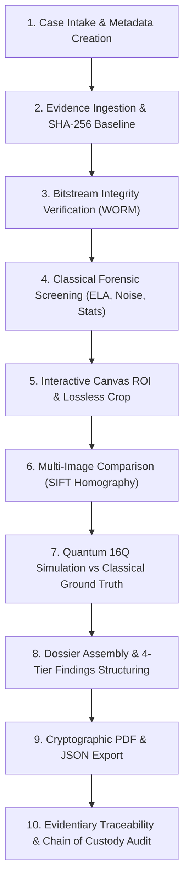

# Q-TRACE End-to-End Testing & Verification Framework

## 1. Test Philosophy & Automated Strategy

Q-TRACE enforces a zero-mock, end-to-end integration testing standard for its core evidentiary workflows. Passing isolated unit tests is insufficient to establish courtroom-grade reproducibility. The master test suite (`tests/test_end_to_end_investigation.py`) exercises the entire platform lifecycle against real database sessions and disk operations using synthetic ground-truth imagery.

---

## 2. The 10-Step Investigation Workflow



### Verification Details by Step:
1. **Step 1 (Case Intake)**: Creates investigation case `QC-E2E-...` and logs primary investigator notes.
2. **Step 2 (Evidence Ingestion)**: Uploads synthetic 128x96 vehicle panel image with known splice tampering. Verifies SHA-256 matches independent `hashlib.sha256()`.
3. **Step 3 (Integrity Audit)**: Calls `/api/v1/evidence/{id}/verify`, validating `is_intact=True`. In a dedicated sub-test (`test_evidence_tamper_detection_in_isolated_env`), modifies file bytes on disk and verifies that the system flags `COMPROMISED` and reports bitstream tampering.
4. **Step 4 (Classical Forensics)**: Executes ELA, noise variance, statistics, and perceptual hash analyzers. Verifies that output contains at least 3 analysis result sets and generated visual masks.
5. **Step 5 (Canvas ROI)**: Creates ROI annotation on anomaly bounding box `[45, 35, 30x30]`, saves confidence and hypothesis, and triggers `/api/v1/rois/{id}/crop` to produce a lossless PNG derivative crop.
6. **Step 6 (Image Comparison)**: Ingests untampered baseline image, runs SIFT homography alignment, computes MAE, SSIM, and generates visual difference heatmap.
7. **Step 7 (Quantum Experiment)**: Extracts 4x4 4-bit patch pair, simulates 16-qubit quantum comparison circuit with 512 measurement shots, and verifies bitwise parity against classical XOR ground truth.
8. **Step 8 (Dossier Assembly)**: Creates a 13-section dossier, compiles structured preview, and verifies 4-tier separation (facts, observations, indicators, hypotheses).
9. **Step 9 (Cryptographic Export)**: Generates both JSON and PDF dossiers, downloads raw bytes, and re-computes SHA-256 independently using `hashlib.sha256()`. Confirms exact match against database records and HTTP headers (`X-Report-SHA256`).
10. **Step 10 (Traceability)**: Traces findings in the exported document back through sections, database records, ROIs, and source evidence SHA-256.

---

## 3. Test Suite Execution & Results

```powershell
# Run the complete end-to-end investigation test suite
python -m pytest tests/test_end_to_end_investigation.py -v
```

### Execution Log:
```text
============================= test session starts =============================
platform win32 -- Python 3.11.9, pytest-9.1.1, pluggy-1.6.0
rootdir: D:\WebDev PROJECTS\quantum qtrace
plugins: anyio-4.12.1, langsmith-0.10.17, platformdirs-4.13.6, cov-7.1.0
collected 4 items

tests/test_end_to_end_investigation.py::test_full_investigation_lifecycle_e2e PASSED [ 25%]
tests/test_end_to_end_investigation.py::test_evidence_tamper_detection_in_isolated_env PASSED [ 50%]
tests/test_end_to_end_investigation.py::test_homography_alignment_fallback_on_featureless_images PASSED [ 75%]
tests/test_end_to_end_investigation.py::test_quantum_comparison_edge_cases PASSED [100%]

============================== 4 passed in 4.54s ==============================
```

