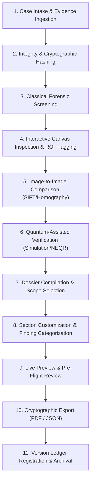

# Q-TRACE Examiner Workflow: End-to-End Investigation Guide

## 1. Introduction & Philosophy

The **Q-TRACE Investigation Platform** is built from the ground up as a **decision-support workstation**. It does not produce automated "guilty" or "fraudulent" binary scores. Instead, it equips forensic examiners, insurance fraud investigators, and digital evidence specialists with scientific rigor, cryptographic traceability, and multi-tier evidentiary structure.

This document describes the standard end-to-end investigative procedure, from initial case intake to the export of an official, court-admissible forensic dossier.

---

## 2. Standard Investigation Lifecycle

---

## 3. Step-by-Step Procedure

### Step 1: Case Creation & Metadata Specification
1. Navigate to the **Cases** workspace.
2. Select **New Investigation Case**.
3. Enter required investigative metadata:
   - **Case Number** (e.g., `QC-2026-CLAIM-9041`): Unique institutional identifier.
   - **Title**: Descriptive investigation label (e.g., *Frontal Bumper Collision Claim - Claim #88219*).
   - **Investigator Name**: Full name and credential identifier of primary examiner.
   - **Target Description**: Vehicle make/model, claim incident specifics, policyholder notes.
4. The system initializes an isolated case workspace with dedicated storage directories.

### Step 2: Evidence Ingestion & Cryptographic Baselines
1. Upload original evidence files (JPEG, PNG, TIFF) directly via drag-and-drop or file selector.
2. **Automatic Verification**:
   - The ingestion pipeline immediately hashes the raw file stream using **SHA-256**.
   - Original files are stored in `storage/originals/` with read-only permissions.
   - EXIF/TIFF metadata is extracted into structured database records.
   - File size, dimensions, color profiles, and MIME types are indexed.
3. The SHA-256 digest forms the immutable root of trust for all subsequent derived artifacts.

### Step 3: Classical Forensic Screening
1. In the **Forensics Engine** tab, run classical analyzers across ingested evidence:
   - **Error Level Analysis (ELA)**: Detects compression discrepancies across multiple quality matrices (90%, 95%).
   - **Copy-Move Forgery Detection (Block DCT / SIFT Keypoint)**: Identifies cloned regions, duplicate textures, or duplicated vehicle damage.
   - **Noise Variance & Residual Analysis (Median / Laplacian Filter)**: Pinpoints anomalous high-frequency noise drops indicative of software smoothing or generative inpainting.
   - **Perceptual Hash Matrix (pHash / dHash / aHash)**: Measures perceptual distance across evidence images.
2. The system generates derived artifacts (lossless PNG heatmaps and masks) and links them to the case evidence database.

### Step 4: Interactive Canvas Inspection & ROI Definition
1. Open the **Canvas & Comparison Engine**.
2. Examine the evidence at up to 1000% digital zoom with synchronized multi-image panning.
3. When an anomaly is identified (e.g., an inconsistent specular highlight, edge blending discontinuity, or cloning artifact):
   - Select the **ROI Annotation Tool** (Rectangle, Ellipse, or Polygon).
   - Draw an annotation bounding the suspect area.
   - Assign a **Forensic Classification**:
     * `suspect_clone`
     * `ela_anomaly`
     * `splice_boundary`
     * `noise_discrepancy`
     * `metadata_inconsistency`
   - Assign an initial **Confidence Score** (0.0 to 1.0) and record descriptive field notes.
4. The system automatically creates a lossless derivative crop artifact and persists normalized bounding box coordinates.

### Step 5: Multi-Image Comparison & Alignment
1. In the comparison workspace, load the suspect evidence image alongside reference images (e.g., pre-accident baseline, insured vehicle at policy inception, or opposite vehicle panel).
2. Run **SIFT / ORB Keypoint Homography Alignment**:
   - The engine identifies matching geometric feature pairs.
   - Computes an affine/perspective homography matrix using RANSAC.
   - Warps the reference image into the suspect image's coordinate frame.
3. Generate **Difference Heatmaps** (Absolute Difference, Structural Similarity SSIM, and Color Inversion):
   - Evaluate whether physical damage matches prior claims or if panels have been cloned from other online imagery.
   - Save comparison pairs directly to the case dossier.

### Step 6: Quantum-Assisted Verification (NEQR / XOR Difference)
1. Where subtle pixel inconsistencies or borderline splicing exists, select candidate 8x8 or 16x16 pixel patches.
2. Submit the patch pair to the **Quantum Proof-of-Concept Engine**:
   - Prepares quantum state representation via Novel Enhanced Quantum Representation (NEQR) or Compact Coordinate Architecture.
   - Executes coherent XOR difference circuits via CNOT gates.
   - Measures output probability distribution over statevector simulation (or Qiskit Aer).
   - Computes quantum difference metric and coupon-collector shot coverage.
3. Record the simulation record ID and execution metrics in the case database.

### Step 7: Dossier Creation & Scope Selection
1. Navigate to the **Dossiers & Reports** workstation (`/reports`).
2. Click **Create New Dossier**:
   - Select target case.
   - Specify dossier title (e.g., *Comprehensive Forensic Evaluation - Claim #88219*).
   - Enter lead examiner name and investigation scope.
3. The system automatically constructs the standard 13-section dossier outline:
   - Section 1: Executive Summary
   - Section 2: Case Overview & Target Scope
   - Section 3: Evidence Register & Custody Log
   - Section 4: Forensic Methodology & Tools
   - Section 5: Metadata & Provenance Audit
   - Section 6: Error Level Analysis (ELA)
   - Section 7: Noise & Compression Variance
   - Section 8: Copy-Move & Cloning Detection
   - Section 9: ROI Evidence Cards
   - Section 10: Image Comparison & Homography
   - Section 11: Quantum Verification Experiments
   - Section 12: Examiner Findings & Hypotheses
   - Section 13: Conclusions & Technical Appendices

### Step 8: Section Customization & 4-Tier Findings Structuring
1. Use the **Dossier Editor** tab to toggle inclusion of specific sections or re-order them.
2. In **Section 12 (Findings & Hypotheses)**, enforce strict evidence-based separation:
   - **Tier 1: Verified Facts**: Mathematical and cryptographic certainties (SHA-256 hashes, file sizes, exact timestamp metadata, EXIF camera serials).
   - **Tier 2: Technical Observations**: Quantifiable analytical measurements (e.g., *ELA residual difference is 24.3 dB in rear bumper panel*, *SIFT homography yielded 42 inlier keypoints with 98.2% alignment accuracy*).
   - **Tier 3: Forensic Indicators**: Methodological interpretations of observations (e.g., *High confidence indicator of digital inpainting along fracture line; noise variance is 3.8x lower than adjacent panel*).
   - **Tier 4: Investigative Hypotheses**: Contextual, non-deterministic explanations for consideration by claims adjusters or legal counsel (e.g., *Hypothesis: Front bumper damage was digitally superimposed from an unrelated vehicle photo prior to insurance claim submission*).
3. Review and edit the **Examiner Conclusion** in Section 13.

### Step 9: Live Document Preview & Pre-Flight Audit
1. Switch to the **Live Preview** tab.
2. Verify that:
   - All evidence items appear with complete SHA-256 hashes.
   - Derivative ROI crops render cleanly without pixelation.
   - Comparison difference heatmaps are correctly aligned and labeled.
   - Quantum simulation tables show circuit depth, qubit count, and shot distribution.
   - Page budget and flowable paragraph text wrap properly without truncation.

### Step 10: Official Report Export
1. Click **Export Official PDF** or **Export Open JSON**:
   - The backend PDF generator compiles the story via ReportLab Platypus.
   - Two-pass `NumberedCanvas` renders running headers, footers, and dynamic page counts (`Page X of Y`).
   - The file is saved to `storage/reports/` with an immutable version number (e.g., `_v1_`).
   - The raw file's SHA-256 is computed and registered in the database ledger.
2. The export ledger displays the new version with download action, timestamp, and verification hash.

### Step 11: Distribution & Verification
1. Distribute the generated PDF or JSON report to stakeholders (legal, claims management, opposing counsel).
2. Recipient verifies report integrity by comparing `sha256sum <file>` against the hash printed on the cover page and recorded in the custody ledger.

