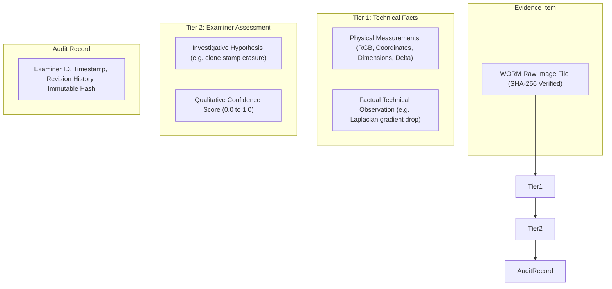

# Forensic Annotations and Evidentiary Integrity Protocol

**Document ID**: `DOC-PART6-005`  
**Classification**: Forensic Methodology & Legal Standard  
**Version**: `1.0.0`  
**Status**: `ACTIVE / PRODUCTION`  
**Target Platform**: Q-TRACE Forensic Workstation

---

## 1. Evidentiary Philosophy and Legal Defensibility

In legal proceedings and insurance fraud litigation, digital evidence annotations are scrutinized under the **Daubert Standard** and **Federal Rule of Evidence 901/702**. Courts consistently reject proprietary "black-box" confidence scores or systems that blur the line between verifiable physical measurements and examiner opinions.

Q-TRACE enforces a **Two-Tier Annotation Architecture**:

---

## 2. Structure of an Evidentiary Annotation

Every Region of Interest (ROI) recorded within Q-TRACE contains the following evidentiary attributes:

### 2.1 Spatial Ground Truth
- **Coordinates $(X, Y, W, H)$**: Explicitly recorded in native, un-interpolated original image pixels.
- **Color Accent**: Visual classification token chosen by the examiner (e.g. Cyan `#00F2FE` for primary anomalies, Amber `#F59E0B` for secondary artifacts, Red `#EF4444` for confirmed damage splices).

### 2.2 Tier 1: Factual Technical Observations (`observation`)
- Represents verifiable, instrument-measured technical attributes.
- Must cite concrete measurements (e.g. RGB variance, ELA rate-distortion discrepancies, PRNU sensor noise attenuation, SIFT displacement vectors).
- **Prohibited**: Conclusory assertions of fraud (e.g., "This bumper was photoshopped").
- **Required**: Objective characterization (e.g., "The $120 \times 80\text{ px}$ region exhibits an average ELA residual intensity of 42.1 compared to 8.4 in surrounding panels, with an unnatural horizontal boundary at $Y = 320$").

### 2.3 Tier 2: Investigative Hypotheses (`hypothesis`)
- Represents the examiner's provisional working theory explaining *why* the physical measurement occurred.
- Clearly segregated in the UI and report outputs as expert opinion rather than settled ground truth.
- *Example*: "Observed localized smoothing and noise absence is consistent with digital healing brush usage to conceal pre-existing impact scratches prior to staging."

### 2.4 Qualitative Confidence Scale (`confidence`)
Examiners assign a normalized score $\in [0.0, 1.0]$ adhering to standardized evidentiary gradations:

| Range | Evidentiary Standard | Forensic Definition |
|:---:|:---|:---|
| `0.85 - 1.00` | Highly Consistent | Multiple corroborating physical signals (e.g. SIFT clone matches corroborated by ELA boundary steps and EXIF software signatures). |
| `0.65 - 0.84` | Moderately Consistent | Strong localized anomaly present, but environmental factors (e.g. severe specular reflection or camera shadow) cannot be ruled out completely. |
| `0.40 - 0.64` | Inconclusive / Ambiguous | Anomaly detected, but signal-to-noise ratio is insufficient for definitive distinction from normal compression artifacts. |
| `< 0.40` | Weak / Incidental | Minor statistical fluctuation; preserved solely for complete chain-of-custody documentation. |

---

## 3. Immutability and Audit Logging

1. **WORM Raw Evidence**: Adding or modifying an annotation never alters the underlying evidentiary file bitstream. Original files in `storage/originals/` remain read-only and cryptographically locked.
2. **Timestamping**: Every annotation tracks its creation timestamp `created_at` and latest edit timestamp `updated_at` (ISO 8601 UTC).
3. **Database Cascades**: Deleting an evidence record cascades to associated ROIs, while deleting an analysis record decouples the ROI without destroying examiner notes (`ON DELETE SET NULL`).
4. **Report Compilation**: During Part 7 report generation, all active ROIs, measurements, factual observations, hypotheses, and derivative crop hashes are compiled into transparent, courtroom-ready forensic dossiers.

