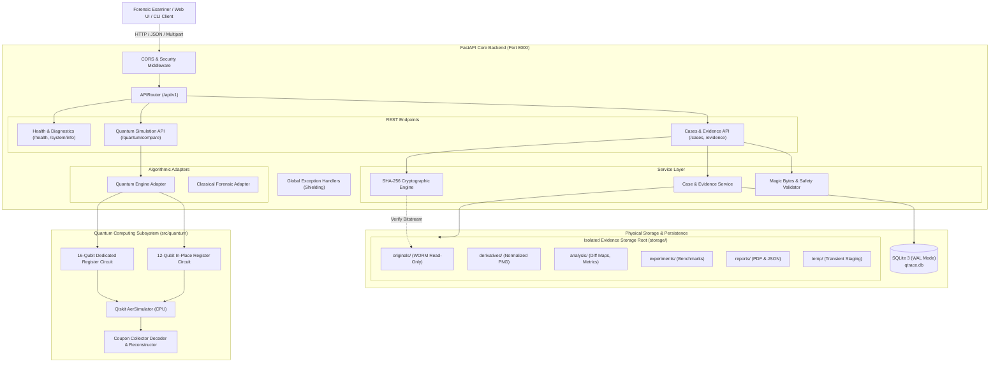

# Q-TRACE Backend Foundation Architecture

## 1. Executive Architectural Overview

The **Q-TRACE** (Quantum-Assisted Digital Image Forensics and Evidence Intelligence Platform) backend foundation is engineered as a high-performance, local-first Python/FastAPI service. It provides a modular, production-ready operational substrate uniting classical forensic analysis, quantum image processing, cryptographic evidence preservation, and case management.

The architecture is designed under four core engineering principles:
1. **Decoupled Service Boundaries**: Clear separation between HTTP routing (`app/api/`), business logic (`app/services/`), persistence (`app/database/`, `app/storage/`), and algorithmic simulation engines (`app/integrations/`, `src/quantum/`, `src/classical/`).
2. **Local-First & Zero External Daemon Dependency**: Runs natively on standard consumer hardware (Windows 11 / Linux / macOS) utilizing embedded SQLite with Write-Ahead Logging (WAL) and local file-system Write-Once-Read-Many (WORM) storage.
3. **Rigorous Evidence Integrity & Forensic Admissibility**: Cryptographic hashing (SHA-256) at the point of ingestion, strict immutability locks on physical disk storage, and on-demand auditing to identify any unauthorized tampering.
4. **Resilient Error Shielding**: Structured domain exceptions and sanitization layers that prevent internal stack traces, filesystem paths, or implementation leaks from reaching external clients.

---

## 2. System Architecture Diagram



---

## 3. Directory Layout and Module Responsibility

The repository maintains an unambiguous layout where the backend application (`backend/app/`) coordinates existing algorithm packages (`src/quantum/`, `src/classical/`, `src/experiments/`):

```text
quantum-qtrace/
├── backend/
│   ├── app/
│   │   ├── api/
│   │   │   ├── __init__.py
│   │   │   ├── cases.py               # Case management & evidence ingestion endpoints
│   │   │   ├── health.py              # Health check & system diagnostics
│   │   │   ├── quantum.py             # Quantum patch comparison endpoints
│   │   │   └── router.py              # Unified v1 router aggregator
│   │   ├── core/
│   │   │   ├── __init__.py
│   │   │   ├── config.py              # Pydantic Settings & environment variables
│   │   │   ├── exceptions.py          # Domain exception hierarchy & error envelope
│   │   │   ├── logging.py             # Millisecond structured console logging
│   │   │   └── security.py            # Security constants and sanitization
│   │   ├── database/
│   │   │   ├── __init__.py
│   │   │   ├── base.py                # SQLAlchemy 2.0 DeclarativeBase
│   │   │   └── session.py             # Engine initialization & SQLite WAL pragmas
│   │   ├── integrations/
│   │   │   ├── __init__.py
│   │   │   ├── classical_adapter.py   # Adapter for classical XOR and metrics
│   │   │   └── quantum_adapter.py     # Adapter for 16Q & 12Q Qiskit circuits
│   │   ├── models/
│   │   │   ├── __init__.py
│   │   │   ├── analysis.py            # Analysis execution records & results JSON
│   │   │   ├── artifact.py            # Artifact records linking diff maps & plots
│   │   │   ├── case.py                # Forensic investigation case container
│   │   │   ├── evidence.py            # Evidence metadata & SHA-256 tracking
│   │   │   └── note.py                # Examiner investigation notes & observations
│   │   ├── schemas/
│   │   │   ├── __init__.py
│   │   │   ├── analysis.py            # Analysis request/response schemas
│   │   │   ├── case.py                # Case CRUD & detail schemas
│   │   │   ├── common.py              # Pagination & standardized error models
│   │   │   ├── evidence.py            # Evidence upload & verification schemas
│   │   │   ├── health.py              # Health & diagnostic response schemas
│   │   │   └── quantum.py             # Quantum comparison schemas & validation
│   │   ├── services/
│   │   │   ├── __init__.py
│   │   │   ├── case_service.py        # Case & evidence business logic
│   │   │   ├── integrity.py           # Streaming SHA-256 hashing & verification
│   │   │   └── validation.py          # Magic-byte inspection & safety guards
│   │   ├── storage/
│   │   │   ├── __init__.py
│   │   │   ├── paths.py               # Safe path resolution & traversal guard
│   │   │   └── service.py             # Multi-directory storage & WORM manager
│   │   └── main.py                    # FastAPI application factory & lifespan
├── docs/                              # Research, audit, and engineering documentation
├── results/                           # Empirical benchmarks and visual plots
├── src/                               # Quantum, classical, and experiment cores
│   ├── classical/                     # Ground-truth comparator & test cases
│   ├── experiments/                   # Automated simulation runner & plotter
│   └── quantum/                       # 16Q/12Q NEQR circuits, state prep, decoder
├── storage/                           # Local filesystem evidence repository
│   ├── analysis/                      # Algorithmic output files
│   ├── derivatives/                   # Normalized thumbnails and RGB working files
│   ├── experiments/                   # Simulation data dumps
│   ├── originals/                     # Untouchable evidence bitstreams (WORM)
│   ├── reports/                       # Generated forensic examination reports
│   └── temp/                          # Transient upload staging
└── tests/                             # Comprehensive automated test suites (79 tests)
```

---

## 4. Application Lifespan & Initialization Sequence

The backend employs FastAPI's modern `@asynccontextmanager` lifespan protocol (`backend/app/main.py`) to manage startup and shutdown state deterministically:

1. **Logging Setup (`backend/app/core/logging.py`)**:
   - Initializes millisecond-precision timestamps (`YYYY-MM-DD HH:MM:SS`).
   - Silences chatty third-party loggers (`uvicorn.access`, `sqlalchemy.engine`).
2. **Database Initialization (`backend/app/database/session.py`)**:
   - Establishes connection pool and registers connection event listeners.
   - Executes SQLite pragmas (`PRAGMA journal_mode=WAL;`, `PRAGMA foreign_keys=ON;`, `PRAGMA synchronous=NORMAL;`).
   - Automatically registers all ORM models with `Base.metadata.create_all(bind=engine)`.
3. **Storage Subsystem Verification (`backend/app/storage/service.py`)**:
   - Ensures the root storage directory and all six dedicated subfolders (`originals`, `derivatives`, `analysis`, `experiments`, `reports`, `temp`) exist on the local filesystem.
4. **Shutdown Cleanup**:
   - Flushes pending database transactions and releases resources cleanly upon receipt of termination signals.

