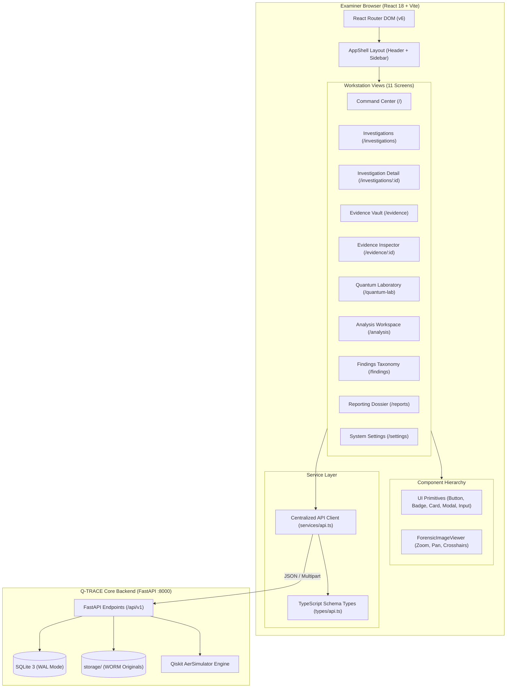

# Q-TRACE Frontend Architecture Specification

## 1. Architectural Philosophy

The **Q-TRACE** frontend is constructed as a modern, local-first single-page application (SPA) designed to communicate seamlessly with the FastAPI backend foundation established in Part 3.



---

## 2. Technology Stack & Key Dependencies

| Technology | Version | Purpose & Selection Rationale |
| :--- | :--- | :--- |
| **React** | `18.3.1` | Component-driven UI rendering with concurrent mode and clean hooks lifecycle. |
| **TypeScript** | `5.6.3` | End-to-end static type safety mirroring backend Pydantic schemas. |
| **Vite** | `5.4.10` | High-speed ESM development server and Rollup production bundler. |
| **Tailwind CSS** | `3.4.15` | Utility-first styling with custom forensic dark tokens and responsive modifiers. |
| **React Router DOM** | `6.28.0` | Declarative client-side routing, URL state synchronization, and parameter extraction. |
| **Lucide React** | `0.460.0` | Minimal, high-legibility forensic icon set (no decorative emojis or AI slop). |
| **Vitest** | `2.1.5` | Fast unit and component test runner matching Vite configuration. |
| **React Testing Library** | `16.0.1` | User-centric DOM testing with JSDOM environment. |

---

## 3. Directory Layout

The frontend codebase is organized under `frontend/src/`:

```text
frontend/
├── index.html                     # HTML5 entry template with dark mode class
├── package.json                   # Dependencies, scripts, and build configuration
├── postcss.config.js              # Tailwind & Autoprefixer plugin configuration
├── tailwind.config.js             # Custom forensic theme, colors, and typography
├── tsconfig.json                  # TypeScript compiler settings & alias mappings
├── vite.config.ts                 # Vite bundler, proxy rules, and Vitest setup
└── src/
    ├── App.tsx                    # Root router provider and route configuration
    ├── index.css                  # Tailwind base directives and custom canvas grid
    ├── main.tsx                   # React root entry point
    ├── components/
    │   ├── layout/
    │   │   ├── AppShell.tsx       # Main workstation layout (Sidebar + Header + Content)
    │   │   ├── Header.tsx         # Route title, global quick badges, and new case button
    │   │   └── Sidebar.tsx        # Navigation links, logo, and live health status
    │   ├── ui/
    │   │   ├── Badge.tsx          # Forensic status badges (verified, compromised, open)
    │   │   ├── Button.tsx         # Primary, secondary, outline, danger, ghost buttons
    │   │   ├── Card.tsx           # Workstation panels, headers, and glow styling
    │   │   ├── EmptyState.tsx     # Actionable empty state placeholders
    │   │   ├── Input.tsx          # Dark text inputs, textareas, and select menus
    │   │   ├── LoadingSpinner.tsx # Monospace loading indicators
    │   │   ├── Modal.tsx          # Accessible dialog with escape handler & backdrop
    │   │   ├── StatusIndicator.tsx# Operational status dots with live telemetry
    │   │   └── Tabs.tsx           # Underline/pill tab switcher
    │   └── viewer/
    │       └── ForensicImageViewer.tsx # Interactive image viewer (zoom, pan, coordinates)
    ├── pages/
    │   ├── AnalysisWorkspacePage.tsx   # Forensic analysis pipelines overview
    │   ├── CommandCenterPage.tsx       # Primary landing dashboard and telemetry
    │   ├── CreateInvestigationPage.tsx # Case registration workflow
    │   ├── EvidenceDetailPage.tsx      # Evidence inspection & cryptographic audit
    │   ├── EvidenceLibraryPage.tsx     # Preserved evidence vault browse & search
    │   ├── EvidenceUploadPage.tsx      # Photographic evidence ingestion form
    │   ├── FindingsPage.tsx            # Evidence findings taxonomy & legal principles
    │   ├── InvestigationDetailPage.tsx # Comprehensive case file dossier review
    │   ├── InvestigationsPage.tsx      # Investigation cases table & filters
    │   ├── QuantumLabPage.tsx          # Interactive 16Q/12Q NEQR simulator
    │   ├── ReportsPage.tsx             # Audit dossier compiler & preview
    │   └── SettingsPage.tsx            # System diagnostics & workstation telemetry
    ├── services/
    │   └── api.ts                 # Centralized, typed API client
    ├── test/
    │   ├── api.test.ts            # API client mock and error handling tests
    │   ├── navigation.test.tsx    # Page rendering and routing tests
    │   ├── setup.ts               # Jest-DOM matchers initialization
    │   └── ui.test.tsx            # Design system component tests
    └── types/
        └── api.ts                 # Strict TypeScript schemas matching FastAPI models
```

---

## 4. Routing Architecture

| Path | Screen Component | Primary Purpose |
| :--- | :--- | :--- |
| `/` | `CommandCenterPage` | Workstation overview, active cases, recent evidence, quick telemetry |
| `/investigations` | `InvestigationsPage` | Paginated investigation register with search and status filters |
| `/investigations/new` | `CreateInvestigationPage` | Form to register a new claim fraud case dossier |
| `/investigations/:caseId` | `InvestigationDetailPage` | Comprehensive case file: evidence items, examiner notes, analyses |
| `/evidence` | `EvidenceLibraryPage` | Browse, filter, and inspect preserved evidence files across cases |
| `/evidence/upload` | `EvidenceUploadPage` | Upload photographic evidence with SHA-256 calculation |
| `/evidence/:evidenceId` | `EvidenceDetailPage` | Full evidence viewer + on-demand cryptographic integrity audit |
| `/analysis` | `AnalysisWorkspacePage` | Select evidence and review available/planned forensic pipelines |
| `/quantum-lab` | `QuantumLabPage` | Interactive 4×4 patch editor & real 16Q/12Q NEQR simulation |
| `/findings` | `FindingsPage` | 4-category evidence findings taxonomy & legal principles |
| `/reports` | `ReportsPage` | Formal evidence dossier preview & audit trail |
| `/settings` | `SettingsPage` | System diagnostics: SQLite WAL status, storage root, Qiskit core |

---

## 5. Performance & Production Bundle Metrics

The application is built using Vite and Rollup with standard code-splitting and asset optimization:

- **Production JavaScript Bundle**: `284.24 kB` (`79.32 kB` gzipped).
- **Production CSS Bundle**: `30.71 kB` (`6.04 kB` gzipped).
- **Initial HTML Document**: `0.94 kB`.
- **Build Duration**: `6.41s`.
- **Zero Runtime Memory Leaks**: Component object URLs are cleared, event listeners detached upon unmount, and canvas image transforms hardware-accelerated.

