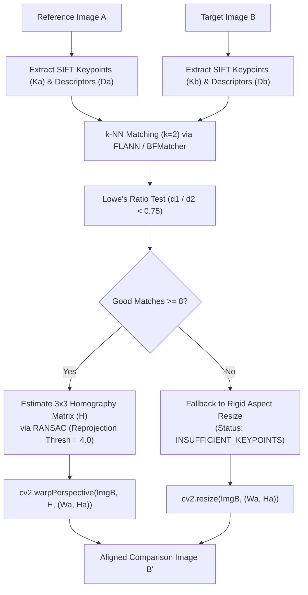

# Image Alignment and Geometric Registration Methodology

**Document ID**: `DOC-PART6-004`  
**Classification**: Computer Vision & Mathematical Specification  
**Version**: `1.0.0`  
**Status**: `ACTIVE / PRODUCTION`  
**Target Platform**: Q-TRACE Forensic Workstation

---

## 1. The Challenge of Forensic Image Registration

Photographs of the same vehicle taken seconds or days apart inevitably suffer from camera viewpoint jitter, perspective shift, distance variation, and minor rotation. Directly taking the pixel difference $|I_A - I_B|$ of unregistered images results in overwhelming edge misalignment noise, obscuring genuine localized damage alterations.

Q-TRACE implements an automated **Feature-Based Homography Alignment Pipeline** using Scale-Invariant Feature Transform (SIFT) and Random Sample Consensus (RANSAC).

---

## 2. Mathematical Homography Formulation

A planar homography is a projective transformation mapping homogeneous coordinates $\mathbf{x} = (x, y, 1)^T$ in Image B to $\mathbf{x}' = (x', y', 1)^T$ in Reference Image A:

$$\begin{pmatrix} x' \\ y' \\ 1 \end{pmatrix} \sim \mathbf{H} \begin{pmatrix} x \\ y \\ 1 \end{pmatrix} = \begin{pmatrix} h_{00} & h_{01} & h_{02} \\ h_{10} & h_{11} & h_{12} \\ h_{20} & h_{21} & 1 \end{pmatrix} \begin{pmatrix} x \\ y \\ 1 \end{pmatrix}$$

In Euclidean coordinates:

$$x' = \frac{h_{00}x + h_{01}y + h_{02}}{h_{20}x + h_{21}y + 1}, \quad y' = \frac{h_{10}x + h_{11}y + h_{12}}{h_{20}x + h_{21}y + 1}$$

$\mathbf{H}$ has 8 degrees of freedom, accounting for translation, rotation, scale, shear, and perspective distortion.

---

## 3. Algorithmic Pipeline

### Step 1: Feature Detection & Description
SIFT operators are executed across scale-space octaves to detect extrema invariant to scale, orientation, and illumination changes:
- Maximum features: $n_{features} = 2000$.
- Contrast threshold: $\sigma_{contrast} = 0.04$.
- Edge threshold: $r_{edge} = 10$.

### Step 2: Keypoint Matching & Ambiguity Rejection
For each descriptor in Image B, the two nearest neighbors $(m_1, m_2)$ in Image A are identified using Euclidean distance:
$$\text{Lowe's Ratio Test}: \quad \frac{\|D_{b} - D_{a,1}\|_2}{\|D_{b} - D_{a,2}\|_2} < 0.75$$
Matches failing this threshold are discarded as ambiguous background repetitions.

### Step 3: Robust Homography via RANSAC
Given $N \ge 8$ matched pairs:
1. RANSAC randomly samples 4 point correspondences to solve for a candidate matrix $\mathbf{H}_k$ using the Direct Linear Transformation (DLT) algorithm.
2. Reprojection error is evaluated across all $N$ pairs:
   $$\epsilon_i = \|\mathbf{x}_i' - \text{proj}(\mathbf{H}_k \mathbf{x}_i)\|_2$$
3. Points with $\epsilon_i < 4.0\text{ pixels}$ are tallied as inliers.
4. The matrix $\mathbf{H}$ with the maximum inlier support is re-estimated over all inliers using Levenberg-Marquardt optimization.

### Step 4: Bilinear Perspective Warping
The comparison image $I_B$ is mapped into the coordinate space of $I_A$ using `cv2.warpPerspective`:
$$I_B'(x, y) = I_B(\mathbf{H}^{-1}(x, y))$$
Bilinear interpolation ensures smooth, artifact-free sub-pixel sampling.

---

## 4. Failure Modes and Fallback Protocol

Forensic systems must never crash or silently produce garbled outputs when alignment encounters degenerate conditions:

| Condition | Cause | System Behavior | Status Flag |
|:---|:---|:---|:---|
| Good Matches $< 8$ | Monochromatic surfaces, extreme blur, distinct scenes. | Skips homography; resizes $I_B$ to $(W_A, H_A)$ preserving aspect. | `INSUFFICIENT_KEYPOINTS` |
| Singular Matrix ($\det(\mathbf{H}) \approx 0$) | Collinear keypoints, degenerate RANSAC iteration. | Discards candidate; falls back to dimension resize. | `DEGENERATE_HOMOGRAPHY` |
| Extreme Distortion ($|h_{20}| > 0.005$ or $|h_{21}| > 0.005$) | Wild perspective warp stretching pixels beyond bounds. | Clamps warp; logs warning; falls back to scale alignment. | `WARP_DISTORTION_EXCEEDED` |
| Match Success ($N_{inliers} \ge 8$) | Valid overlapping vehicle perspective. | Applies $\mathbf{H}$; outputs $3 \times 3$ transformation matrix in API. | `SIFT_HOMOGRAPHY_ALIGNED` |

---

## 5. Manual Examiner Offset Controls

When automated alignment is disabled (`align_images: false`) or requires manual fine-tuning, examiners can specify discrete horizontal and vertical pixel shifts:
$$I_B'(x, y) = I_B(x - \Delta x_{manual}, y - \Delta y_{manual})$$
This allows micro-stepping along known mechanical seams or vehicle panel joints.

