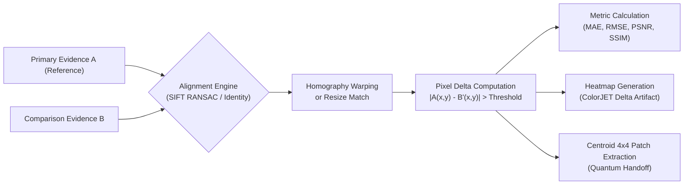

# Image Comparison Engine and Forensic Difference Analysis

**Document ID**: `DOC-PART6-003`  
**Classification**: Scientific & Algorithmic Specification  
**Version**: `1.0.0`  
**Status**: `ACTIVE / PRODUCTION`  
**Target Platform**: Q-TRACE Forensic Workstation

---

## 1. Overview and Forensic Objectives

In insurance fraud investigations, examiners frequently receive multiple photographs depicting the same alleged incident:
1. "Before" vs "After" repair photographs.
2. Photographs taken at slightly different angles or times of day.
3. Repurposed images from older unrelated claims submitted with digital alterations.

The **Q-TRACE Image Comparison Engine** provides rigorous mathematical and visual comparisons between two evidentiary images (Evidence A and Evidence B), accounting for spatial misalignment, color differences, and localized tampering.

---

## 2. Visual Comparison Modes

The workstation UI implements four interactive inspection modes:

### 2.1 Split-Wipe (Swipe) Mode
- A vertical divider line cuts through the viewport at position $P_{split} \in [0\%, 100\%]$.
- Viewport pixels to the left of the divider render Evidence A; pixels to the right render Evidence B.
- Implemented via hardware-accelerated CSS `clip-path: inset(0 0 0 P_split%)` preventing layout reflow.
- Allows immediate visual discovery of subtle structural changes (e.g. added dents, cloned reflections, adjusted body seams).

### 2.2 Opacity Blend Overlay Mode
- Evidence B is rendered directly atop Evidence A with adjustable alpha transparency $\alpha \in [0.0, 1.0]$.
- Enables examiners to spot geometric scaling anomalies, rotation differences, and localized object insertions.

### 2.3 Difference Heatmap Overlay Mode
- Renders the computed absolute pixel delta map layered over Evidence A with configurable opacity and `mix-blend-mode: screen`.
- Zero-difference pixels are transparent; altered or displaced regions glow from cyan to bright red.

### 2.4 Side-by-Side Dual Synchronized Mode
- Displays both images adjacent to each other with synchronized pan and zoom offsets.
- Allows independent visual cross-examination without occlusion.

---

## 3. Mathematical Delta Metrics

For reference image $I_A$ and aligned comparison image $I_B'$ of dimensions $W \times H$ across color channels $C \in \{R, G, B\}$:

### 3.1 Mean Absolute Error (MAE)
Quantifies average per-pixel intensity deviation:

$$\text{MAE} = \frac{1}{W \cdot H \cdot 3} \sum_{x=0}^{W-1} \sum_{y=0}^{H-1} \sum_{c=0}^{2} |I_A(x, y, c) - I_B'(x, y, c)|$$

### 3.2 Root Mean Square Error (RMSE)
Penalizes large localized intensity differences more severely than uniform noise:

$$\text{RMSE} = \sqrt{\frac{1}{W \cdot H \cdot 3} \sum_{x=0}^{W-1} \sum_{y=0}^{H-1} \sum_{c=0}^{2} \left(I_A(x, y, c) - I_B'(x, y, c)\right)^2}$$

### 3.3 Peak Signal-to-Noise Ratio (PSNR)
Measures dynamic range relative to reconstruction error (in decibels):

$$\text{PSNR} = 10 \cdot \log_{10} \left( \frac{\text{MAX}_I^2}{\text{MSE}} \right) = 20 \cdot \log_{10} \left( \frac{255}{\text{RMSE}} \right)$$

- $\text{PSNR} > 40\text{ dB}$: Near-identical bitstreams (imperceptible compression differences).
- $30\text{ dB} \le \text{PSNR} \le 40\text{ dB}$: Minor JPEG re-compression or subtle color grading.
- $\text{PSNR} < 25\text{ dB}$: Substantial structural modification or distinct scenes.

### 3.4 Structural Similarity Index (SSIM)
Evaluates perceptual structural preservation across luminance $l$, contrast $c$, and structure $s$:

$$\text{SSIM}(x, y) = \frac{(2\mu_x\mu_y + C_1)(2\sigma_{xy} + C_2)}{(\mu_x^2 + \mu_y^2 + C_1)(\sigma_x^2 + \sigma_y^2 + C_2)}$$

Where $C_1 = (0.01 \cdot 255)^2$ and $C_2 = (0.03 \cdot 255)^2$. An SSIM score of $1.000$ indicates identical structural topology.

### 3.5 Difference Pixel Count & Percentage
A binary indicator flags significant pixel alteration using an examiner-defined sensitivity threshold $\tau \in [0, 255]$ (default $\tau = 15$):

$$\Delta_{mask}(x, y) = \begin{cases} 1, & \max_{c} |I_A(x,y,c) - I_B'(x,y,c)| \ge \tau \\ 0, & \text{otherwise} \end{cases}$$

$$\text{Diff Percentage} = \frac{\sum_{x,y} \Delta_{mask}(x, y)}{W \cdot H} \times 100\%$$

---

## 4. Difference Heatmap Generation

The backend pipeline generates an inspection-grade difference artifact:
1. Gray delta map is extracted: $D_{gray}(x, y) = \frac{1}{3} \sum_c |I_A(x,y,c) - I_B'(x,y,c)|$.
2. Threshold $\tau$ is applied to suppress camera sensor shot noise.
3. The remaining deltas are normalized to $[0, 255]$ and mapped through the OpenCV `COLORMAP_JET` spectrum:
   - Deep Blue: Zero deviation.
   - Cyan / Green: Moderate deviation ($15 - 40$ intensity units).
   - Yellow / Red: Severe deviation ($> 80$ intensity units, indicating foreign spliced objects).
4. Saved as a PNG derivative artifact in `storage/analysis/` and registered with SHA-256 integrity digest.

