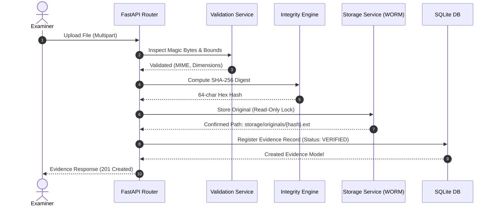

# Q-TRACE Cryptographic Evidence Integrity System

## 1. Foundational Distinction: Integrity vs. Authenticity

A critical principle of digital forensic intelligence is the strict distinction between **Bitstream Integrity** and **Image Authenticity**:

| Concept | Definition | Verification Mechanism | Forensic Interpretation in Q-TRACE |
| :--- | :--- | :--- | :--- |
| **Bitstream Integrity** | Proves that the physical sequence of bytes stored on disk is byte-for-byte identical to the file received at the moment of ingestion. | Cryptographic Hashing (**SHA-256**) | Guarantees chain of custody and detects unauthorized file tampering or disk corruption. |
| **Image Authenticity** | Determines whether the photograph depicts a genuine, unaltered physical scene rather than a manipulated, spliced, or AI-generated artifact. | Algorithmic Forensics (**Quantum Comparison**, Classical XOR, ELA, Noise Analysis) | Identifies whether the content was fabricated prior to or during claim submission. |

> [!IMPORTANT]
> A photograph can possess 100% bitstream integrity (an unaltered JPEG file whose hash matches the record perfectly) while being completely fraudulent (e.g. a spliced or photoshopped bumper created prior to submission). Conversely, a completely authentic photograph whose metadata was updated by an automated backup tool loses bitstream integrity even though the visual scene is genuine.

---

## 2. Ingestion Cryptographic Workflow

During evidence ingestion via `POST /api/v1/cases/{case_id}/evidence`:



1. **Streaming Digest Calculation**: File bytes are hashed using SHA-256 (`backend/app/services/integrity.py`) in 64 KB memory chunks, ensuring consistent performance without memory spikes on multi-megabyte files.
2. **Database Registration**: The 64-character hexadecimal digest is recorded in `evidence.sha256_hash` alongside image dimensions, MIME type, file size, and creation timestamp.
3. **Initial State**: Evidence is registered with `status = "VERIFIED"`.

---

## 3. On-Demand Integrity Auditing

Forensic investigators can audit the physical integrity of any evidence item at any time via:
`POST /api/v1/evidence/{evidence_id}/verify`

### 3.1 Verification Algorithm
```python
def verify_file_integrity(file_path: Path, expected_sha256: str) -> Tuple[bool, str]:
    current_hash = compute_sha256_file(file_path)
    is_intact = (current_hash.lower() == expected_sha256.lower())
    return is_intact, current_hash
```

1. The service reads the preserved file from `storage/originals/` and re-computes its SHA-256 digest from physical disk sectors.
2. The recomputed digest is compared against `evidence.sha256_hash` stored in the database.
3. If hashes match:
   - `is_intact = True`
   - `status` remains `VERIFIED`.
4. If any byte was altered (bit flip, external modification, file truncation):
   - `is_intact = False`
   - `evidence.status` is immediately updated to `COMPROMISED`.
   - An alert message is logged and returned in the API response.

### 3.2 Audit Response Envelope
```json
{
  "evidence_id": "a5e8c1b2-3f4d-4e5a-b6c7-8d9e0f1a2b3c",
  "original_filename": "hood_damage.png",
  "stored_sha256": "e3b0c44298fc1c149afbf4c8996fb92427ae41e4649b934ca495991b7852b855",
  "current_sha256": "e3b0c44298fc1c149afbf4c8996fb92427ae41e4649b934ca495991b7852b855",
  "is_intact": true,
  "verified_at": "2026-11-19T21:10:00.000000Z",
  "status": "VERIFIED",
  "message": "Evidence file bitstream is identical to original ingestion hash."
}
```

---

## 4. Chain-of-Custody Defensibility

By maintaining unalterable WORM files on disk, cryptographic hash records in SQLite, and an audit trail of examiner notes, Q-TRACE establishes a defensible chain of custody suitable for university coursework evaluation and professional evidentiary demonstration.

