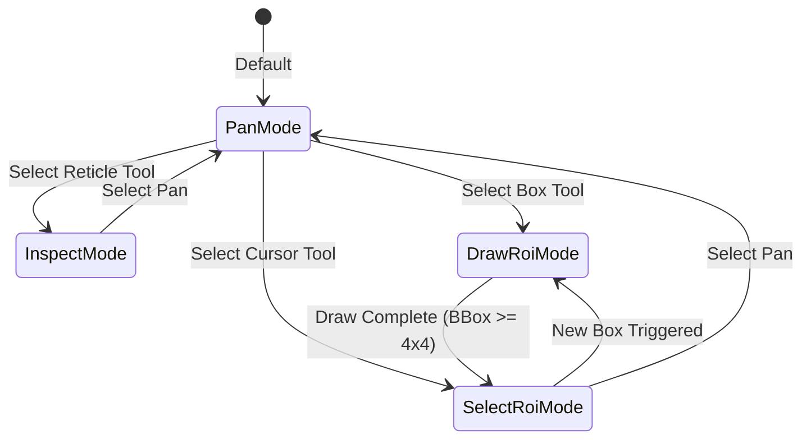

# Interactive Forensic Canvas Architecture

**Document ID**: `DOC-PART6-001`  
**Classification**: Technical Architecture Specification  
**Version**: `1.0.0`  
**Status**: `ACTIVE / PRODUCTION`  
**Target Platform**: Q-TRACE Forensic Workstation (Windows 11 / Electron / Web Browser)

---

## 1. Architectural Philosophy and Requirements

Digital image forensics requires an interactive visualization environment capable of presenting high-resolution multi-megapixel photographs without distortion, interpolation artifacts, or coordinate drift. Standard web image viewers fail forensic scrutiny because they interpolate sub-pixels, crop non-viewable regions, and lack reversible mappings between screen pixels and the underlying evidentiary bitstream.

The **Q-TRACE Interactive Forensic Canvas Engine** solves these challenges by implementing an invariant coordinate transformation pipeline, sub-millisecond hardware-accelerated pan/zoom rendering, and seamless layer blending.

```mermaid
flowchart TD
    subgraph Coordinate Spaces
        ImgSpace["Original Image Coordinate Space (X, Y) [0..W, 0..H]"]
        CanvasSpace["Virtual Canvas Transform (Zoom, Pan Offset)"]
        ScreenSpace["Viewport Screen Coordinates (clientX, clientY)"]
    end

    ImgSpace -->|"Scale S, Translate (Px, Py)"| CanvasSpace
    CanvasSpace -->|"Bounding Box Relative Offset"| ScreenSpace
    ScreenSpace -->|"Inverse Matrix [S^-1, -P]"| ImgSpace

    subgraph Layer Stack
        BaseLayer["Evidence Layer (Evidence A: WORM Read-Only)"]
        CompLayer["Comparison Layer (Split-Wipe / Blend / Difference)"]
        CandLayer["Candidate Algorithm Regions (Part 5 Overlays)"]
        RoiLayer["Examiner Regions of Interest (Interactive SVG/DOM)"]
        CursorLayer["Forensic Reticle & Live Pixel Readout"]
    end

    BaseLayer --> CompLayer --> CandLayer --> RoiLayer --> CursorLayer
```

---

## 2. Invariant Coordinate Transformation Engine

All forensic annotations, algorithm bounding boxes, keypoints, and sub-region crops must be defined strictly in **Original Image Coordinates** $(X_{img}, Y_{img})$:

$$\begin{pmatrix} X_{screen} \\ Y_{screen} \\ 1 \end{pmatrix} = \begin{pmatrix} S & 0 & P_x \\ 0 & S & P_y \\ 0 & 0 & 1 \end{pmatrix} \begin{pmatrix} X_{img} \\ Y_{img} \\ 1 \end{pmatrix}$$

Where:
- $S \in [0.1, 10.0]$ is the scale factor (zoom level).
- $(P_x, P_y)$ is the translation offset in viewport screen pixels.
- The inverse transformation mapping screen cursor coordinates back to exact original image pixels is given by:

$$X_{img} = \left\lfloor \frac{X_{screen} - P_x}{S} \right\rfloor, \quad Y_{img} = \left\lfloor \frac{Y_{screen} - P_y}{S} \right\rfloor$$

### 2.1 Boundary Clamping and Sub-Pixel Invariance
To prevent out-of-bounds indexing or fractional pixel aliasing:
1. $X_{img}$ is clamped to $[0, W - 1]$ and $Y_{img}$ to $[0, H - 1]$.
2. For zoom levels $S \ge 3.0$ ($300\%$), CSS `image-rendering: pixelated` is dynamically engaged. This disables bilinear smoothing and renders distinct physical pixel blocks, enabling examiners to inspect individual sensor grid artifacts and discrete cosine transform $8 \times 8$ block boundaries.

---

## 3. Tool State Machine

The canvas operates across four orthogonal interaction modes:

1. **`pan` (Pan Viewport)**:
   - Left-click drag adjusts translation offset $(P_x, P_y)$ with smooth hardware-accelerated CSS transform rendering.
   - Mouse wheel adjusts scale $S$ dynamically centered on the cursor focal point $(X_{mouse}, Y_{mouse})$.
2. **`inspect` (Precision Reticle)**:
   - Locks a forensic crosshair reticle to the cursor.
   - Real-time offscreen canvas sampling queries $[R, G, B]$ byte values and computes perceived luminance:
     $$Y = 0.299R + 0.587G + 0.114B$$
   - Displays continuous coordinates $(X_{img}, Y_{img})$ on the persistent bottom status bar.
3. **`roi_draw` (Region Drawing)**:
   - Primary mousedown establishes origin anchor $(X_0, Y_0)$.
   - Mousemove projects live dashed bounding rectangle with dynamic dimensions readout $(W \times H\text{ px})$.
   - Mouseup validates minimum area ($W \ge 4, H \ge 4$), persists the new ROI to the backend SQLite store, and transitions to `roi_select`.
4. **`roi_select` (ROI Selection & Geometry Editing)**:
   - Click to focus an existing ROI.
   - Displays 4-corner interactive resize handles (`nw`, `ne`, `sw`, `se`) and drag-to-reposition bounding box.
   - Live geometry updates synchronize to the backend via `PATCH /api/v1/rois/{roi_id}`.

---

## 4. Multi-Layer Blending Stack

The canvas supports multiple visualization layers composited in hardware:

| Layer Index | Name | Render Tech | Description |
|:---:|:---|:---|:---|
| `L0` | Primary Image | `` / DOM | Original evidentiary photograph served from `/api/v1/evidence/{id}/file`. |
| `L1` | Comparison Swipe / Blend | `clip-path` / CSS Opacity | Secondary photograph cropped by horizontal split slider or blended with opacity $\alpha \in [0.0, 1.0]$. |
| `L2` | Difference Heatmap | `mix-blend-mode: screen` | Derivative difference map artifact generated by the SIFT homography comparison engine. |
| `L3` | Candidate Algorithm Regions | Scaled absolute `
` | Overlays from Part 5 automated pipelines (ELA, Noise, CMFD, Consensus). |
| `L4` | Examiner ROIs | Scaled absolute `
` + SVG | Examiner-created bounding boxes with color-coded tags and confidence badges. |
| `L5` | Inspection Reticle & UI | Overlay HUD | Floating toolbar, zoom presets (1:1, Fit), split slider, and status bar. |

---

## 5. Performance and Frame Budget

- **Zoom / Pan Operations**: Executed entirely via GPU-accelerated CSS `transform: translate3d(...) scale(...)`. Render overhead is $< 2.5\text{ ms}$ per frame, guaranteeing a continuous 60 FPS refresh rate on integrated Intel Iris Xe / AMD Radeon graphics.
- **Pixel Sampling**: Uses a single background 2D canvas initialized once per evidence load with `{ willReadFrequently: true }`. Pixel queries execute in $< 0.1\text{ ms}$ on `mousemove`.
- **Memory Footprint**: Images are kept in browser memory as single textured elements without duplicating bitmap buffers across layers.

