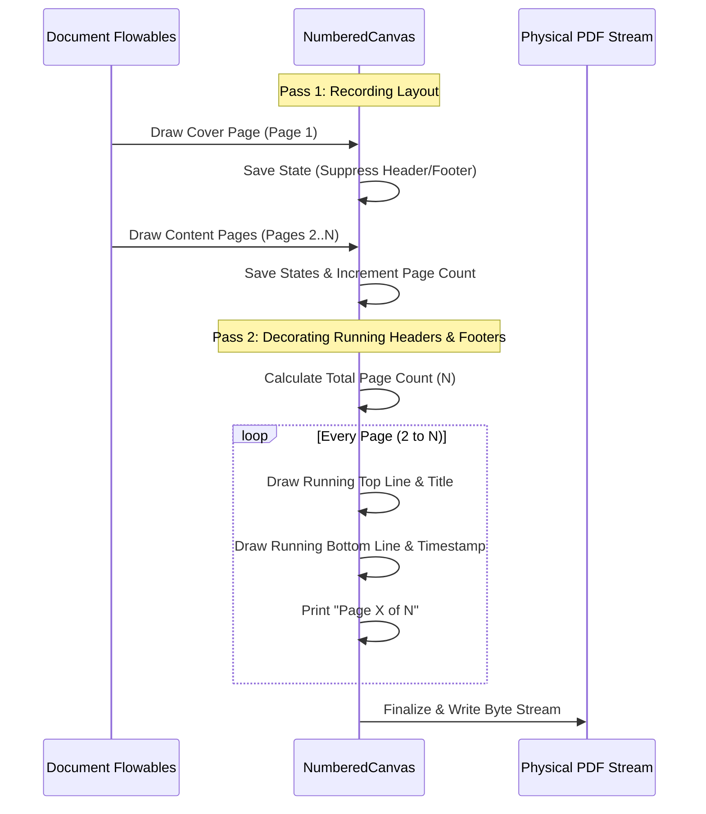

# PDF Export Methodology and Visual Styling

**Document ID**: `DOC-PART7-004`  
**Classification**: Document Design & PDF Engineering Specification  
**Version**: `1.0.0`  
**Status**: `ACTIVE / PRODUCTION`  
**Target Platform**: ReportLab 5.1.0 / Standard PDF Viewers

---

## 1. Document Engineering Principles

Forensic investigation dossiers require visual clarity, structured readability, and technical elegance. Documents that feature sloppy typography, overlapping text, broken tables, or unnumbered pages fail to inspire confidence in legal or insurance proceedings.

The **Q-TRACE PDF Export Engine** is built strictly using **ReportLab Platypus** (Page Layout and Typography Using Scripts), enforcing:
- Fixed grid geometry with standard Letter margins ($36\text{ pt} = 0.5\text{ in}$).
- Deterministic page breaking with `KeepTogether` blocks preventing orphaned table headers.
- Flowable tables with autowrapping text paragraphs preventing horizontal clipping.
- Embedded high-resolution derivative crop imagery and difference heatmaps.

---

## 2. Dynamic Two-Pass Pagination (`NumberedCanvas`)

Standard single-pass PDF generators cannot know the total page count of a document before reaching the end. Q-TRACE solves this using a two-pass `NumberedCanvas`:



```python
class NumberedCanvas(canvas.Canvas):
    def __init__(self, *args, **kwargs):
        super().__init__(*args, **kwargs)
        self._saved_page_states = []

    def showPage(self):
        self._saved_page_states.append(dict(self.__dict__))
        self._startPage()

    def save(self):
        num_pages = len(self._saved_page_states)
        for state in self._saved_page_states:
            self.__dict__.update(state)
            self.draw_page_decorations(num_pages)
            super().showPage()
        super().save()
```

---

## 3. Visual Styling & Color Tokens

The visual language reflects a serious, high-tech forensic laboratory:

| Element | Hex Code | RGB Equivalent | Purpose |
|:---|:---|:---|:---|
| Primary Headers | `#0F172A` | `(15, 23, 42)` | Deep slate-900; commanding, authoritative title text. |
| Accent Brand | `#0284C7` | `(2, 132, 199)` | Cyan-600; section sub-headers, primary dividers, and borders. |
| Body Text | `#1E293B` | `(30, 41, 59)` | Slate-800; readable high-contrast body typography. |
| Muted Labels | `#64748B` | `(100, 116, 139)` | Slate-500; timestamps, minor footnotes, running headers. |
| Table Headers | `#F1F5F9` | `(241, 245, 249)` | Slate-100; clear background fill for column headers. |
| Card Surface | `#F8FAFC` | `(248, 250, 252)` | Slate-50; subtle container fill for ROI and comparison cards. |
| Border Lines | `#CBD5E1` | `(203, 213, 225)` | Slate-300; 0.5 pt grid lines for tables and boxes. |
| Legal Callout | `#FEF3C7` | `(254, 243, 199)` | Amber-100; highlighted background for confidentiality notice. |

---

## 4. Typography Scale

- **Cover Brand**: Helvetica-Bold, 24 pt, leading 28 pt, Cyan-600.
- **Cover Title**: Helvetica-Bold, 18 pt, leading 22 pt, Slate-900.
- **Section Heading 1**: Helvetica-Bold, 13 pt, leading 17 pt, Slate-900 with `keepWithNext=True`.
- **Section Heading 2**: Helvetica-Bold, 10 pt, leading 14 pt, Cyan-600 with `keepWithNext=True`.
- **Body Text**: Helvetica, 9 pt, leading 13 pt, Slate-800.
- **Monospaced Code / Hashes**: Courier, 7.5 pt, leading 9.5 pt, Slate-900 (for cryptographic SHA-256 strings).

---

## 5. Flowable Table Architecture

To eliminate overlapping text or broken table margins:
1. Every table cell containing text is wrapped in a `Paragraph` flowable with explicit styles.
2. Explicit `colWidths` are defined for every table, summing exactly to $540\text{ pt}$ (matching available page printable width: $612\text{ pt} - 2 \times 36\text{ pt} = 540\text{ pt}$).
3. Vertical alignments are pinned to `VALIGN: TOP` to preserve clean baselines.
4. Cell padding is maintained between $2\text{ pt}$ and $4\text{ pt}$ to optimize data density without visual clutter.

---

## 6. Embedded Imagery Protocol

1. **Crop Thumbnails**: Extracted lossless 24-bit PNG crops are rendered at $1.5 \times 1.1\text{ inches}$ with explicit aspect preservation.
2. **Difference Heatmaps**: SIFT delta maps are rendered at $1.6 \times 1.2\text{ inches}$.
3. **Missing Image Graceful Handling**: If a referenced artifact file has been moved or deleted from disk, the generator logs a warning, skips the image flowable, and renders the text details cleanly without throwing an unhandled exception.

