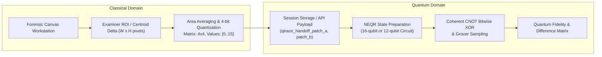

# Quantum-ROI Integration and Patch Extraction Pipeline

**Document ID**: `DOC-PART6-007`  
**Classification**: Quantum-Classical Hybrid Architecture  
**Version**: `1.0.0`  
**Status**: `ACTIVE / PRODUCTION`  
**Target Platform**: Q-TRACE Hybrid Computing Pipeline

---

## 1. The Quantum-Classical Forensic Bridge

A foundational architectural principle of Q-TRACE is that quantum computing is not an isolated novelty, but an integrated high-precision verification tool within the forensic workflow. Classical computer vision operates efficiently over multi-megapixel macro images ($2048 \times 1536$), isolating suspicious macro regions. The Quantum Laboratory (Part 2) then performs rigorous coherent image comparisons over localized $4 \times 4$ micro-patches.

The **Canvas-to-Quantum Bridge** enables examiners to seamlessly transition from visual inspection to quantum circuit simulation in a single click.

---

## 2. Mathematical Patch Extraction & Quantization

Given an arbitrary cropped region of interest $I_{crop}$ of dimensions $W \times H$ (where $W, H \ge 4$):

### 2.1 Spatial Downsampling to $4 \times 4$
The region is partitioned into a uniform $4 \times 4$ grid of cells $C_{r, c}$ for $r, c \in \{0, 1, 2, 3\}$. The mean grayscale intensity $\mu_{r, c}$ within each cell is computed using area averaging:

$$\mu_{r, c} = \frac{1}{|C_{r, c}|} \sum_{(x, y) \in C_{r, c}} \left( 0.299 \cdot R(x, y) + 0.587 \cdot G(x, y) + 0.114 \cdot B(x, y) \right)$$

This provides robust antialiasing, preserving average luminance even across noisy or textured vehicle paint surfaces.

### 2.2 4-bit Value Quantization
The Quantum NEQR representation encodes pixel values using $q = 4$ color qubits ($2^4 = 16$ discrete gray levels $\in [0, 15]$). Continuous luminance values $\mu_{r, c} \in [0.0, 255.0]$ are quantized via linear companding:

$$P(r, c) = \text{round}\left( \frac{\mu_{r, c}}{255.0} \times 15.0 \right), \quad P(r, c) \in \{0, 1, 2, \dots, 15\}$$

---

## 3. Dual-Image Comparison Centroid Extraction

When comparing Evidence A and Evidence B via the SIFT Homography Comparison Engine:
1. The pipeline identifies the spatial centroid $(\bar{x}, \bar{y})$ of the maximal difference cluster in the binary delta mask $\Delta_{mask}$:
   $$\bar{x} = \frac{\sum x \cdot \Delta_{mask}(x, y)}{\sum \Delta_{mask}(x, y)}, \quad \bar{y} = \frac{\sum y \cdot \Delta_{mask}(x, y)}{\sum \Delta_{mask}(x, y)}$$
2. A $32 \times 32\text{ pixel}$ bounding window is placed around $(\bar{x}, \bar{y})$ in both Image A and aligned Image B.
3. Both windows are downsampled and quantized into matching $4 \times 4$ matrices:
   - `suggested_quantum_patch_a`: $4 \times 4$ matrix from Image A.
   - `suggested_quantum_patch_b`: $4 \times 4$ matrix from Image B.
4. These complementary matrices are returned in `ImageComparisonResponse`.

---

## 4. Frontend Cross-Module Handoff

The workstation implements zero-latency browser session persistence:
1. In `ForensicCanvasPage`, clicking **"Send Centroid Delta to Quantum Lab"** stores:
   - `sessionStorage.setItem("qtrace_handoff_patch_a", JSON.stringify(patchA));`
   - `sessionStorage.setItem("qtrace_handoff_patch_b", JSON.stringify(patchB));`
   - `sessionStorage.setItem("qtrace_handoff_patch", JSON.stringify(patchA));`
2. The user is navigated to `/quantum-lab`.
3. `QuantumLabPage` detects the presence of handoff tokens during `useEffect` mounting, automatically initializes Patch A and Patch B inputs with the imported matrices, displays a confirmation banner, and purges the session keys to prevent stale state.

---

## 5. Quantum Circuit Execution

Once in the Quantum Laboratory, the investigator can execute the simulation across either verified circuit architecture:
- **16-Qubit NEQR**: Coherent dual-register comparison with 4 position qubits, $2 \times 4$ color qubits, 4 ancilla qubits, and CNOT bitwise XOR gates.
- **12-Qubit In-Place**: Reduced qubit footprint using in-place modulo arithmetic.
- **Reconstructed Difference Map**: Returns 100% exact bitwise match with classical differences, accompanied by circuit depth, gate counts, and execution telemetry.

