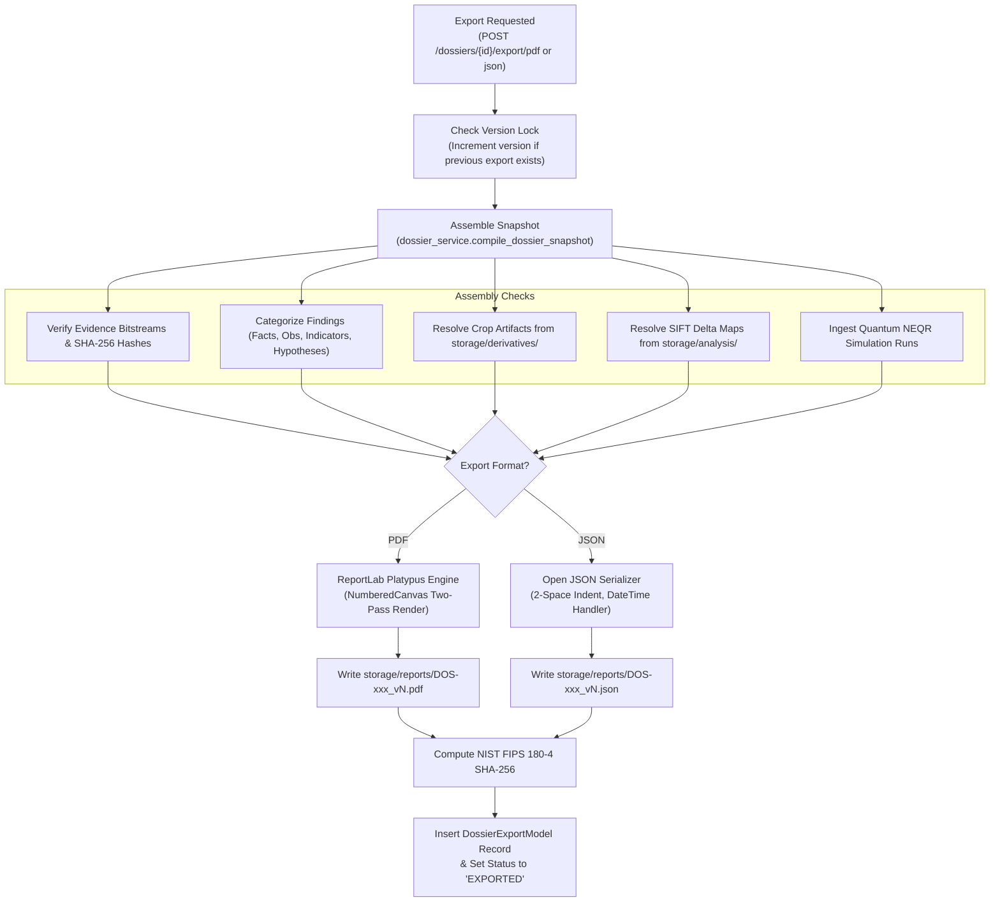

# Report Generation Engine and Snapshot Compilation

**Document ID**: `DOC-PART7-003`  
**Classification**: Software Engineering & Workflow Specification  
**Version**: `1.0.0`  
**Status**: `ACTIVE / PRODUCTION`  
**Target Platform**: Q-TRACE Backend Service

---

## 1. Engine Overview and Responsibilities

The **Q-TRACE Report Generation Engine** is responsible for transforming fragmented case records, raw evidentiary bitstreams, algorithmic telemetry matrices, and examiner notes into coherent, unified investigation dossiers.

The engine operates in two distinct phases:
1. **Phase 1: Deterministic Snapshot Assembly:** Gathers, cross-references, validates, and normalizes all case assets in-memory.
2. **Phase 2: Format-Specific Rendering:** Dispatches the normalized snapshot to either the `ForensicPDFGenerator` or the JSON Serializer.



---

## 2. The 13 Standard Report Sections

Every generated dossier comprises 13 standard, logically structured sections:

| Index | Section Key | Title | Primary Content |
|:---:|:---|:---|:---|
| `0` | `COVER` | Cover & Incident Identification | Dossier number, case reference, platform brand, author, version, status, and legal confidentiality warning. |
| `1` | `EXECUTIVE_SUMMARY` | Executive Summary | Concise high-level synthesis, total evidence examined, ROIs identified, and overview of conclusions. |
| `2` | `SCOPE` | Investigation Scope & Mandate | Examination questions, analytical boundaries, and documented physical constraints. |
| `3` | `EVIDENCE_REGISTER` | Evidence Register & Cryptographic Integrity | Table of all selected evidence files with format, dimensions, size, and SHA-256 hashes. |
| `4` | `CHAIN_OF_CUSTODY` | Chain of Custody & Verification Log | Chronological audit log of ingestion, WORM locking, and integrity audits. |
| `5` | `METHODOLOGY` | Forensic Methodology Catalog | Reference table of executed techniques (ELA, Noise, CMFD, Stats, Homography) with parameters. |
| `6` | `FINDINGS` | Structured Forensic Findings | Categorized findings: Verified Facts, Algorithmic Telemetry, Potential Indicators, and Hypotheses. |
| `7` | `ROI_EVIDENCE` | Regions of Interest & Derivative Evidence | Detailed ROI cards with origin coordinates $(X, Y)$, size $(W \times H)$, confidence, and **embedded lossless crop images**. |
| `8` | `IMAGE_COMPARISONS` | SIFT Homography Image Comparisons | Dual-image comparison metrics (MAE, RMSE, PSNR, SSIM, delta ratio) and **embedded difference heatmaps**. |
| `9` | `QUANTUM_EXPERIMENTS` | Quantum Image Processing Simulation | NEQR simulation telemetry, qubit counts (16Q / 12Q), shots, fidelity, and classical XOR ground truth agreement. |
| `10` | `EXAMINER_NOTES` | Examiner Notes & Chronology | Verbatim case journal notes logged by investigators during review. |
| `11` | `CONCLUSIONS` | Examiner Conclusions & Recommendations | Final professional synthesis by the examiner with actionable guidance for claims handlers. |
| `12` | `APPENDICES` | Technical Appendices & Completeness | Software runtime specifications (Python, ReportLab, OpenCV, Qiskit) and evidence completeness disclosures. |

---

## 3. Findings Categorization Protocol

To comply with the Daubert evidentiary standard, the snapshot compiler classifies all findings into four mutually exclusive tiers:

```
+--------------------------------------------------------------------------+
| 1. DIRECTLY OBSERVED TECHNICAL FACTS                                     |
| Objective, immutable physical properties (e.g. SHA-256 bitstream match,   |
| camera EXIF model tag, native resolution 2048x1536).                     |
+--------------------------------------------------------------------------+
| 2. MEASURED ALGORITHMIC TELEMETRY                                        |
| Direct mathematical outputs from computer vision instruments (e.g. ELA   |
| mean residual of 42.1, SIFT displacement vectors, SSIM score of 0.978).  |
+--------------------------------------------------------------------------+
| 3. POTENTIAL MANIPULATION INDICATORS                                     |
| Statistically anomalous patterns that warrant scrutiny (e.g. high-error  |
| ELA cluster on rear bumper, localized noise variance drop).              |
+--------------------------------------------------------------------------+
| 4. INVESTIGATIVE HYPOTHESES                                              |
| Working explanations formulated by the examiner (e.g. potential clone     |
| stamp brush erasure of pre-existing scratch).                            |
+--------------------------------------------------------------------------+
```

---

## 4. Performance & Memory Management

- **Streaming Image Ingestion:** Embedded images for crops and heatmaps are loaded on demand via ReportLab's `Image` flowable and scaled to standard thumbnail dimensions ($1.5 \times 1.1\text{ inches}$). Original multi-megapixel evidence files are never loaded into the PDF memory buffer.
- **Memory Consumption:** Compilation and PDF rendering of a 3-page to 10-page dossier requires $< 25\text{ MB}$ of RAM and executes in $< 1.5\text{ seconds}$ on an Intel Core i5 / AMD Ryzen 5 CPU.
- **Temporary File Isolation:** Intermediate rendered streams are written directly to disk via atomic buffers, ensuring temporary memory is reclaimed immediately upon completion.

