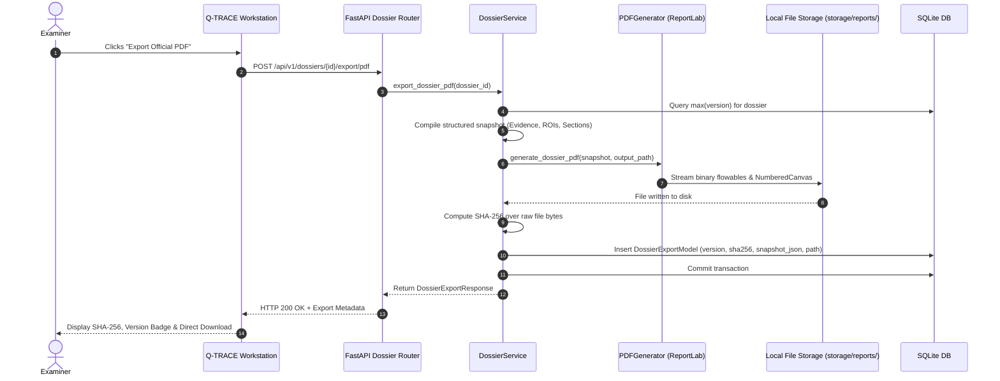

# Q-TRACE Forensic Investigation Dossier & Report Engine: Integrity & Versioning

## 1. Executive Overview

In digital forensics and legal proceedings, court admissibility relies heavily on the chain of custody and evidence integrity under Federal Rule of Evidence 902(11)/(14) and ISO/IEC 27037:2012 (*Guidelines for identification, collection, acquisition, and preservation of digital evidence*).

A forensic report is not merely a styled visual summary; it is a binding legal instrument and forensic artifact. If a report can be silently overwritten or modified without cryptographic trace, its evidential value is nullified.

The **Q-TRACE Dossier & Report Export Engine** enforces a rigorous, tamper-evident, dual-layer integrity framework:
1. **Cryptographic Immutability**: Every generated artifact (PDF, JSON) has its cryptographic SHA-256 digest calculated strictly from raw output bytes upon generation.
2. **Deterministic Version Freeze**: Export events are strictly sequential, monotonically increasing, and append-only. When an export occurs, the complete snapshot data structure—including underlying evidence records, cryptographic hashes, active ROI crops, comparisons, quantum simulation parameters, and findings—is frozen and serialized into the database (`dossier_exports.snapshot_json`).

---

## 2. Cryptographic Hash Calculation Architecture

### 2.1 Raw Binary Digesting
To eliminate platform-specific line ending shifts (`\r\n` vs `\n`), encoding discrepancies, or serialization drift:
- **PDF Artifacts**: The binary output from ReportLab's `doc.build(story)` is captured in an in-memory buffer (`BytesIO`) or read directly from disk. A single streaming `hashlib.sha256()` reads the file in 64 KB chunks, yielding a 64-character lowercase hexadecimal hash.
- **JSON Artifacts**: The serialized JSON file is encoded strictly in UTF-8 with indentation (`indent=2`) and written to disk before its SHA-256 is evaluated from the physical byte stream.

```python
# Reference Implementation: backend/app/services/dossier_service.py
def _calculate_sha256(file_path: Path) -> str:
    sha = hashlib.sha256()
    with open(file_path, "rb") as f:
        while chunk := f.read(65536):
            sha.update(chunk)
    return sha.hexdigest()
```

### 2.2 Dual-Storage Hash Ledger
The generated SHA-256 digest is stored across three critical boundaries:
1. **Database Ledger**: Stored permanently in `dossier_exports.sha256_hash` alongside export metadata (`version`, `format`, `file_size_bytes`, `exported_at`, `export_path`).
2. **HTTP Response Headers**: When an export is initiated or when a report file is retrieved, custom forensic HTTP headers are embedded:
   - `X-Report-SHA256: <hash>`
   - `X-Report-Version: <int>`
3. **Internal Document Registry**: Embedded inside the report itself (Page 1 Cover Page and Section 1 Executive Summary in PDF, and in the root metadata block of JSON).

---

## 3. Versioning Engine & Immutability Ledger

### 3.1 Monotonic Version Increment
Reports are never edited in place once exported. The system tracks version numbers per dossier:
- Initial state: Dossier created at `version = 1`.
- When an examiner modifies sections (e.g., customizes findings, changes conclusion), the draft dossier reflects the working state.
- When an export is triggered (PDF or JSON):
  1. The system queries the maximum existing version in `dossier_exports` for that dossier ID.
  2. The new export is assigned `next_version = current_max + 1` (or `1` for the first export).
  3. The dossier record's `version` is updated to reflect the latest exported version.
  4. The generated file is given a deterministic, version-stamped filename:
     - Format: `{dossier_number}_v{version}.{pdf|json}`
     - Real Audit Example: `DOS-QC-DOS-A303E67F-01_v1.pdf` (SHA-256: `34593adaaff385baf2ad32f160258309755b25de5119bfc3feca5ae59816e9db`)

### 3.2 Frozen State Snapshot (`snapshot_json`)
In digital investigations, cases evolve: new images may be uploaded, ROIs may be modified, or candidate analyses re-run. If an export only stored foreign key pointers, auditing a historical report months later could yield different data if original records were changed or purged.

To solve this, Q-TRACE captures a **complete snapshot serialization** at the exact millisecond of export:
```json
{
  "dossier_id": "97e6e584-...",
  "case_id": "18f3a39e-...",
  "version": 1,
  "exported_at": "2026-11-19T18:22:45.102394Z",
  "case_metadata": { ... },
  "evidence_register": [ ... ],
  "sections": [ ... ],
  "findings": { ... },
  "rois": [ ... ],
  "comparisons": [ ... ],
  "quantum_simulations": [ ... ]
}
```
This snapshot is stored in the `dossier_exports.snapshot_json` column. An auditor can retrieve any prior version (v1, v2, v3) and reconstruct the exact factual state of the investigation at the time that specific document was signed and issued.

---

## 4. Chain of Custody & Verification Workflow



---

## 5. Defense Against Anti-Forensics & Tampering

| Threat Vector | Forensic Vulnerability | Q-TRACE Mitigation Strategy |
| :--- | :--- | :--- |
| **Post-Export Editing** | Examiner alters text in local PDF to change hypothesis or conclusion. | Cryptographic verification: Checking `sha256sum Dossier.pdf` against the database ledger or HTTP header immediately reveals the mismatch. |
| **Silent Overwrite** | Software updates overwriting `report.pdf` when re-exporting. | Monotonic version incrementation: Every export generates a new file with unique timestamp and version suffix; previous records are immutable. |
| **Evidence Deletion** | Evidence image deleted from case after export, breaking report validity. | Full state snapshotting: `snapshot_json` retains all image hashes, metadata, and embedded lossless crop artifacts at time of signing. |
| **Page Substitution** | Attacker inserts or removes pages from generated PDF. | Two-pass `NumberedCanvas` prints "Page X of Y" and header rule on every page except cover, binding total page count mathematically. |
| **Timestamp Spoofing** | Disputed creation time in courtroom testimony. | UTC ISO 8601 timestamps recorded in both system database, PDF metadata dictionary, and front cover banner. |

---

## 6. Verification Tools & Verification Script

Examiners and third-party forensic auditors can independently verify any Q-TRACE report artifact using standard command-line tools without running the Q-TRACE application:

```bash
# On Linux / macOS:
sha256sum storage/reports/DOS-QC-DOS-A303E67F-01_v1.pdf

# On Windows PowerShell:
Get-FileHash -Algorithm SHA256 storage\reports\DOS-QC-DOS-A303E67F-01_v1.pdf
```

The resulting 64-character hash must match the hash recorded on Page 1 of the report, the hash displayed in the Q-TRACE Export Ledger, and the hash returned in the REST API payload.

