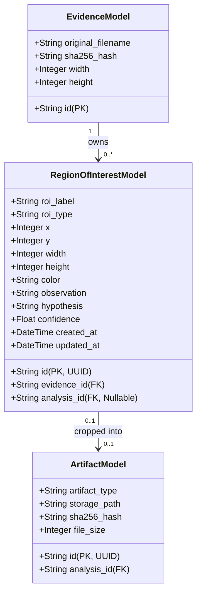

# Region of Interest (ROI) Management and Annotation System

**Document ID**: `DOC-PART6-002`  
**Classification**: Engineering & Functional Specification  
**Version**: `1.0.0`  
**Status**: `ACTIVE / PRODUCTION`  
**Target Platform**: Q-TRACE Forensic Workstation

---

## 1. Overview and Purpose

In forensic image analysis, examiners must isolate and document specific sub-regions exhibiting signs of tampering, splicing, cloning, or physical damage. The **Region of Interest (ROI) Management System** provides a structured, legally sound mechanism to record, annotate, modify, and export discrete image patches while maintaining an unbroken chain of custody.



---

## 2. ROI Typology and Classification

Q-TRACE enforces a strict taxonomic distinction between automated algorithmic candidates and human examiner determinations:

| ROI Type Token | Creator / Source | Description |
|:---|:---|:---|
| `EXAMINER_CREATED` | Human Investigator | Manually drawn or refined bounding box identifying suspicious areas (e.g. scratch discontinuity, unnatural texture boundary). |
| `ALGORITHM_CANDIDATE` | Part 5 Forensic Pipeline | Automated bounding box generated by computer vision heuristics (e.g., ELA high-error cluster, noise variance outlier, SIFT copy-move keypoint cluster). |
| `COMPARISON_DELTA` | Part 6 Comparison Engine | Centroid or bounding cluster resulting from pixel-level or feature-aligned image difference maps. |

---

## 3. Database Schema and Storage Invariants

ROIs are stored in SQLite (WAL mode enabled) under the `regions_of_interest` table:

```sql
CREATE TABLE regions_of_interest (
    id VARCHAR(36) PRIMARY KEY,
    evidence_id VARCHAR(36) NOT NULL REFERENCES evidence(id) ON DELETE CASCADE,
    analysis_id VARCHAR(36) REFERENCES analyses(id) ON DELETE SET NULL,
    roi_label VARCHAR(128) NOT NULL,
    roi_type VARCHAR(32) NOT NULL DEFAULT 'EXAMINER_CREATED',
    x INTEGER NOT NULL,
    y INTEGER NOT NULL,
    width INTEGER NOT NULL,
    height INTEGER NOT NULL,
    color VARCHAR(16) NOT NULL DEFAULT '#00F2FE',
    observation TEXT,
    hypothesis TEXT,
    confidence REAL,
    created_at DATETIME NOT NULL DEFAULT CURRENT_TIMESTAMP,
    updated_at DATETIME NOT NULL DEFAULT CURRENT_TIMESTAMP
);

CREATE INDEX ix_rois_evidence_id ON regions_of_interest(evidence_id);
```

### 3.1 Strict Coordinate Invariance
- Coordinates $(X, Y)$ represent the **top-left origin** in the non-rotated, non-scaled native pixel grid of the original evidentiary file.
- The backend validates that $X \ge 0$, $Y \ge 0$, $W \ge 4$, $H \ge 4$.
- During creation and updates, the service verifies that $X + W \le W_{image}$ and $Y + H \le H_{image}$. If coordinates exceed dimensions, the backend either rejects the payload with HTTP 422 or clamps the dimensions cleanly to the maximum boundary.

---

## 4. Interactive Geometry Manipulation

The user interface exposes four interactive resizing and moving handles:

```
(X, Y)  [NW]-------------------------[NE] (X+W, Y)
          |                            |
          |       [MOVE AREA]          |
          |                            |
(X, Y+H)[SW]-------------------------[SE] (X+W, Y+H)
```

1. **Move Operation**:
   - Dragging the center interior shifts $(X, Y)$ by $(\Delta X, \Delta Y)$ while preserving $(W, H)$.
   - Clamped to $[0, W_{img} - W]$ and $[0, H_{img} - H]$.
2. **Corner Resize Operations**:
   - `SE` Handle: modifies $(W, H) \to (W + \Delta X, H + \Delta Y)$.
   - `NW` Handle: modifies $(X, Y) \to (X + \Delta X, Y + \Delta Y)$ and $(W, H) \to (W - \Delta X, H - \Delta Y)$.
   - `NE` Handle: modifies $Y \to Y + \Delta Y$, $H \to H - \Delta Y$, and $W \to W + \Delta X$.
   - `SW` Handle: modifies $X \to X + \Delta X$, $W \to W - \Delta X$, and $H \to H + \Delta Y$.
3. **Debounced Persistence**:
   - Geometry adjustments during mouse dragging update the local React state optimistically at 60 FPS.
   - On `mouseup`, the finalized coordinates are committed to the backend via `PATCH /api/v1/rois/{roi_id}`.

---

## 5. Forensic Annotation Protocol

Every ROI supports dual-tier forensic documentation:

1. **Factual Technical Observation (`observation`)**:
   - Objective, measurable characteristics observed in the pixel data.
   - *Example*: `"Discontinuous edge gradient along bumper crease; local Laplacian variance drops from 340 to 45 over a 12-pixel span."`
2. **Investigative Hypothesis (`hypothesis`)**:
   - Working forensic theory formulated by the examiner.
   - *Example*: `"Potential digital inpainting or scratch erasure using clone stamp tool; requires sensor noise verification."`
3. **Qualitative Examiner Confidence (`confidence`)**:
   - Normalized float $\in [0.0, 1.0]$ representing investigator certainty.
   - Distinct from automated probability scores to maintain courtroom defensibility.

