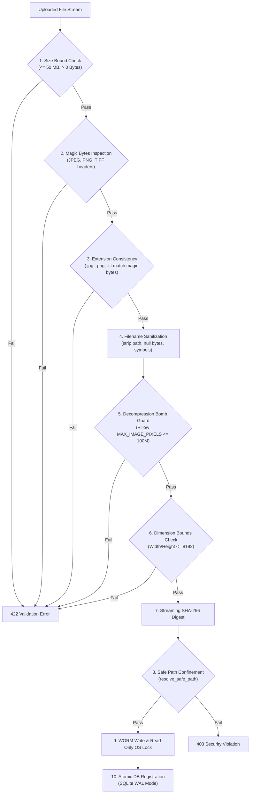

# Q-TRACE Security Baseline & Defensive Engineering

## 1. Threat Model & Security Objectives

In digital image forensics, the software application itself is exposed to potentially hostile or weaponized media files submitted by claimants, attackers, or untrusted third parties. The security objectives of Q-TRACE are:

1. **Host Integrity**: Ensure malicious image files cannot trigger remote code execution, buffer overflows, or arbitrary file system overwrite.
2. **Denial-of-Service (DoS) Resistance**: Prevent decompression bombs (zip/pixel bombs) and unbounded memory allocations from exhausting workstation RAM or CPU.
3. **Evidence Tamper Resistance**: Ensure digital evidence files cannot be surreptitiously altered or swapped post-ingestion.
4. **Information Leakage Suppression**: Prevent internal file paths, stack traces, and database schemas from being exposed in API error responses.

---

## 2. Multi-Stage Defense-in-Depth Pipeline



---

## 3. Defense Mechanisms Detailed

### 3.1 Magic-Byte Header Inspection
Attackers often disguise executable payloads or HTML scripts by appending an image extension (e.g. `exploit.php.png` or `payload.jpg`). Q-TRACE ignores client-provided `Content-Type` headers and examines the initial byte sequence:
- **JPEG**: `0xFF 0xD8 0xFF`
- **PNG**: `0x89 0x50 0x4E 0x47 0x0D 0x0A 0x1A 0x0A` (`\x89PNG\r\n\x1a\n`)
- **TIFF**: `II*\x00` (Little-Endian) or `MM\x00*` (Big-Endian)

Any file failing this signature check is rejected with `ValidationException`.

### 3.2 Decompression-Bomb Mitigation
An uncompressed or recursively compressed image file (e.g. 10 KB file expanding to 10 GB in memory) can cause an Out-Of-Memory (OOM) crash. Q-TRACE mitigates this attack vector through two independent constraints:
1. Setting Pillow's pixel safety threshold:
   ```python
   Image.MAX_IMAGE_PIXELS = 100_000_000
   ```
2. Enforcing structural dimension constraints (`MAX_IMAGE_WIDTH = 8192`, `MAX_IMAGE_HEIGHT = 8192`). Images exceeding 8192 pixels in either dimension are rejected before rasterization.

### 3.3 Filename Sanitization
Filenames provided by clients are stripped of directory separators, null bytes (`\0`), and non-printable control characters:
```python
sanitized = re.sub(r'[^a-zA-Z0-9_\-\.]', '_', filename)
```
Overly long filenames are truncated to 128 characters preserving the safe extension.

### 3.4 Directory Traversal Confinement
All storage operations verify that the resolved physical file path is strictly located within the designated category root (`backend/app/storage/paths.py`). Any attempt to traverse parent directories (`../` or `..\\`) triggers a `SecurityException` and returns a 403 Forbidden status code.

### 3.5 Write-Once-Read-Many (WORM) Locking
Once written to disk, original evidence files have their OS write permissions removed (`chmod` stripping write flags). Deduplication prevents overwriting existing evidence files with conflicting payloads.

### 3.6 Exception Shielding & Information Hiding
Raw Python tracebacks, database driver error details, and physical host directories are suppressed from API responses (`backend/app/core/exceptions.py`). Production exceptions log complete details to local stdout with timestamped correlation while returning sanitized error codes to clients.

