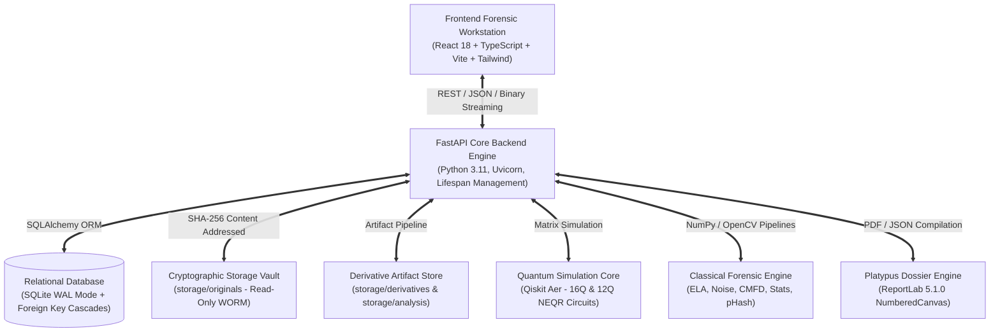

# Q-TRACE System Integration Architecture

## 1. System Overview & Integrated Topology

Q-TRACE is an integrated, local-first digital image forensics and evidence intelligence workstation. It is engineered specifically for investigating motor-vehicle insurance claim photographic evidence without requiring external cloud infrastructure, GPUs, or physical quantum computers.

---

## 2. Integrated Subsystem Boundaries

| Subsystem | Responsibilities | Communication Mechanism | Concurrency Model |
| :--- | :--- | :--- | :--- |
| **Frontend Workstation** | UI rendering, 60 FPS canvas pan/zoom, ROI drawing, heatmap visualization, report editing. | HTTP/1.1 REST to `/api/v1` with typed Axios client. | Single-threaded JavaScript event loop with React 18 transitions. |
| **Backend Core** | Request validation, business logic, lifespan startup/shutdown, transaction boundary. | FastAPI asynchronous routing, Pydantic schemas. | Uvicorn ASGI event loop with synchronous threadpool execution for CPU tasks. |
| **Storage Subsystem** | WORM preservation of original evidence, collision avoidance, path traversal defense. | `StorageService` using `pathlib.Path` and atomic OS operations. | Read-only file permissions (`S_IREAD`) on original evidence files. |
| **Classical Engine** | Multi-signal signal processing (ELA, noise residuals, keypoint CMFD, entropy, pHash). | `ForensicPipeline` orchestrating registered `ForensicTechnique` modules. | In-process NumPy/OpenCV vectorization. |
| **Quantum Laboratory** | Coherent XOR comparison, state preparation, measurement collapse, sampling coverage. | `QuantumAdapter` bridging FastAPI to `QuantumComparator16Q/12Q`. | Qiskit Aer statevector simulation on local CPU. |
| **Reporting Engine** | Multi-page PDF generation, two-pass `NumberedCanvas`, SHA-256 freezing, JSON snapshotting. | `ForensicPDFGenerator` and `DossierService`. | ReportLab Platypus flowable story compilation in memory and streaming to disk. |

---

## 3. Storage Hierarchy & Path Containment

The physical storage hierarchy is compartmentalized into dedicated directories:
- `storage/originals/`: Read-only, content-addressed evidentiary bitstreams (`<sha256>.<ext>`). Never overwritten or mutated.
- `storage/derivatives/`: Lossless PNG crops and SIFT difference heatmaps generated by the interactive canvas.
- `storage/analysis/`: Classical forensic output artifacts (ELA masks, noise variance maps, copy-move feature graphs).
- `storage/reports/`: Cryptographically signed PDF and JSON exported forensic dossiers (`DOS-<case>-<num>_v<ver>.<ext>`).
- `storage/temp/`: Ephemeral staging for decompression checks and multipart streaming.

All file operations route through `backend/app/storage/service.py:resolve_safe_path()`, enforcing strict boundary checks to prevent directory traversal attacks (`../`).

