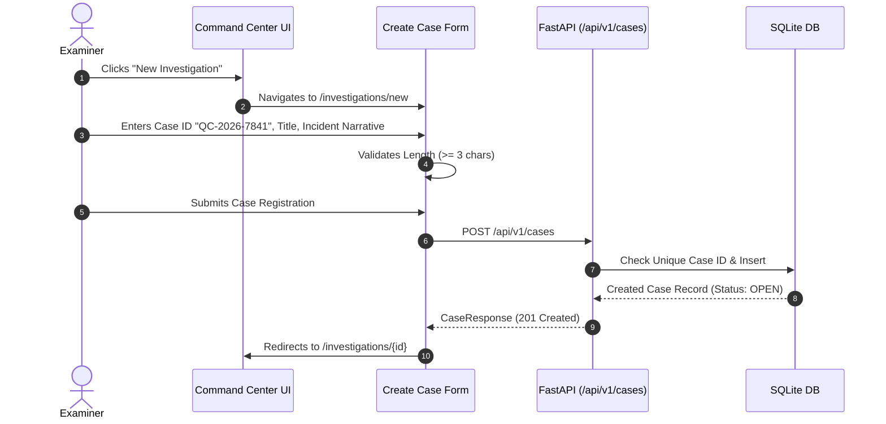

# Q-TRACE Forensic Investigator User Journeys

## 1. Primary User Personas

### Persona A: Senior Insurance Fraud Investigator (SIU Specialist)
- **Role**: Reviews suspicious motor vehicle damage insurance claims, assesses staged collision patterns, and determines whether an incident warrants denial, further physical inspection, or prosecution referral.
- **Pain Points**: Low confidence in automated "fraud scores"; claimants submitting reused, photoshopped, or internet-sourced damage photographs; difficulty proving photographic chain of custody in court or arbitration.
- **Goals in Q-TRACE**: Register investigation dossiers, lock original claim photographs permanently under WORM preservation, review examiner observations, and compile audit-ready reporting dossiers.

### Persona B: Digital Image Forensic Analyst / Quantum Researcher
- **Role**: Technical specialist analyzing image signals, sensor noise residuals, compression artifacts, and evaluating experimental quantum image processing algorithms on high-priority suspicious regions.
- **Pain Points**: Proprietary black-box forensic software that hides methodology; lack of experimental testbeds for quantum image representations (NEQR).
- **Goals in Q-TRACE**: Inspect high-resolution evidence, audit cryptographic SHA-256 digests, run 16Q/12Q quantum NEQR comparison simulations on suspect patches, and verify quantum reconstruction against deterministic classical ground truth.

---

## 2. End-to-End User Journeys

### Journey 1: Registering a New Investigation Dossier

---

### Journey 2: Evidence Ingestion & WORM Preservation Locking
1. From the investigation detail screen (`/investigations/{id}`), the examiner clicks **"Ingest Image Evidence"**.
2. Selects the claimant's JPEG damage photograph from the local file dialog.
3. The browser validates that file size is within limits (< 50 MB) and presents a thumbnail preview.
4. The examiner confirms the upload:
   - The file is streamed via multipart form to `POST /api/v1/cases/{case_id}/evidence`.
   - The backend validates magic bytes (`\xFF\xD8\xFF`), applies Pillow decompression-bomb protection, calculates the streaming SHA-256 hash, writes to `storage/originals/{hash}.jpg`, and removes write permissions (`chmod` read-only).
5. The UI updates immediately, displaying the WORM-locked evidence card with the permanent SHA-256 hash.

---

### Journey 3: Interactive Forensic Evidence Inspection
1. The examiner navigates to `/evidence/{id}` to inspect the master damage photograph.
2. The **Forensic Image Viewer** renders the preserved image:
   - The examiner zooms in up to 500% to examine paint transfer seams and scratch textures.
   - Panning allows smooth repositioning across the vehicle panel.
   - Hovering over the image reveals real-time pixel coordinates (`X: 1420px, Y: 890px`) in a monospace crosshair overlay.
   - The examiner toggles 1:1 actual pixel mode to inspect un-interpolated sensor noise.

---

### Journey 4: On-Demand Cryptographic Integrity Auditing
1. On the evidence inspection screen, the examiner clicks **"Audit Bitstream Integrity"**.
2. The UI calls `POST /api/v1/evidence/{id}/verify`.
3. The backend opens the physical file on disk, streams its byte sequence through SHA-256, and compares it to the original ingestion hash.
4. The UI displays an instant audit card:
   - **Pristine Evidence**: Displays green checkmark, "Bitstream Invariant (VERIFIED)", audit timestamp, and confirmation that disk bytes match the original record.
   - **Tampered Evidence**: If any byte was altered on disk, displays red alert, flags status as `COMPROMISED`, and highlights the hash discrepancy.

---

### Journey 5: Coherent Quantum NEQR Patch Comparison Simulation
1. The examiner navigates to the **Quantum Laboratory** (`/quantum-lab`).
2. Selects a suspect 4×4 pixel region or applies the **"Single-Pixel Tamper"** preset:
   - Patch A represents the baseline reference area.
   - Patch B has pixel `(1, 1)` altered from intensity 8 to 14.
3. Selects the quantum architecture:
   - Chooses **16-Qubit NEQR** (dedicated difference register baseline) or **12-Qubit In-Place** (93.8% memory reduction).
4. Configures measurement sampling shots (e.g. 1,024 shots).
5. Clicks **"Execute Quantum Simulation"**:
   - The backend builds the quantum circuit, encodes position and pixel states into superposition, applies bitwise CNOT XOR subtraction, executes on `AerSimulator`, and decodes measurement collapse frequencies via coupon collector analysis.
6. The UI displays:
   - **100% Fidelity** against classical ground truth.
   - Circuit telemetry: 16 qubits, depth 38, 68 quantum gates.
   - Reconstructed 4×4 difference heatmap highlighting the exact tampered coordinate `(1, 1)`.
   - Complete 100% sampling coverage ratio.

---

### Journey 6: Recording Qualitative Observations & Compiling Dossiers
1. The examiner returns to the investigation case file (`/investigations/{id}`).
2. Under the **"Examiner Observations"** tab, writes a structured observation:
   *"Microscopic review reveals inconsistent specular highlights along the front bumper edge. Quantum NEQR simulation confirms a localized intensity disparity at coordinate (1, 1). Claimant should be interviewed regarding prior damage history."*
3. Clicks **"Save Observation"** to commit the note with UTC timestamps to the case file.
4. Navigates to **Reports** (`/reports`) to preview the unified dossier combining incident background, evidence inventory, SHA-256 ledger, quantum experiment outputs, and examiner notes.

